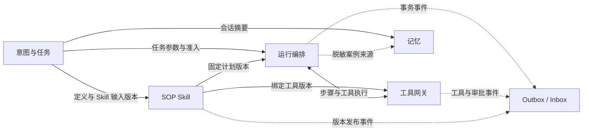
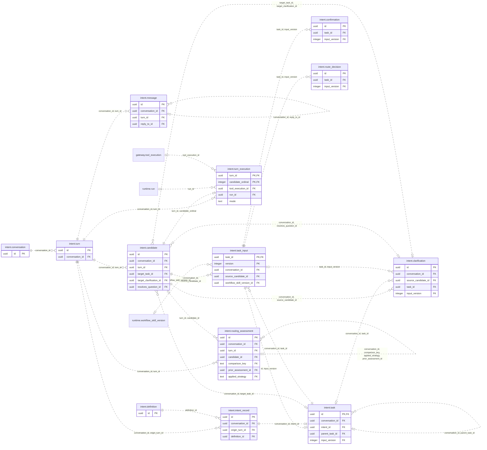
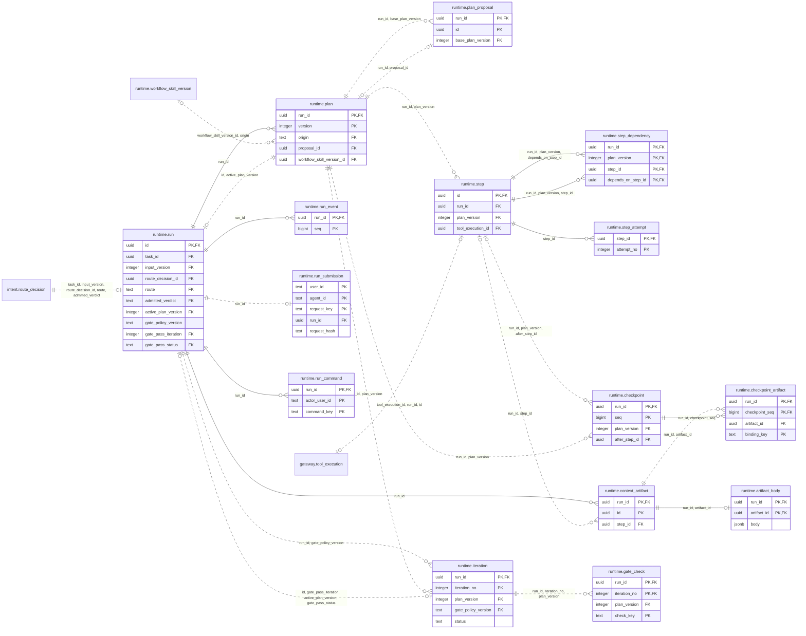
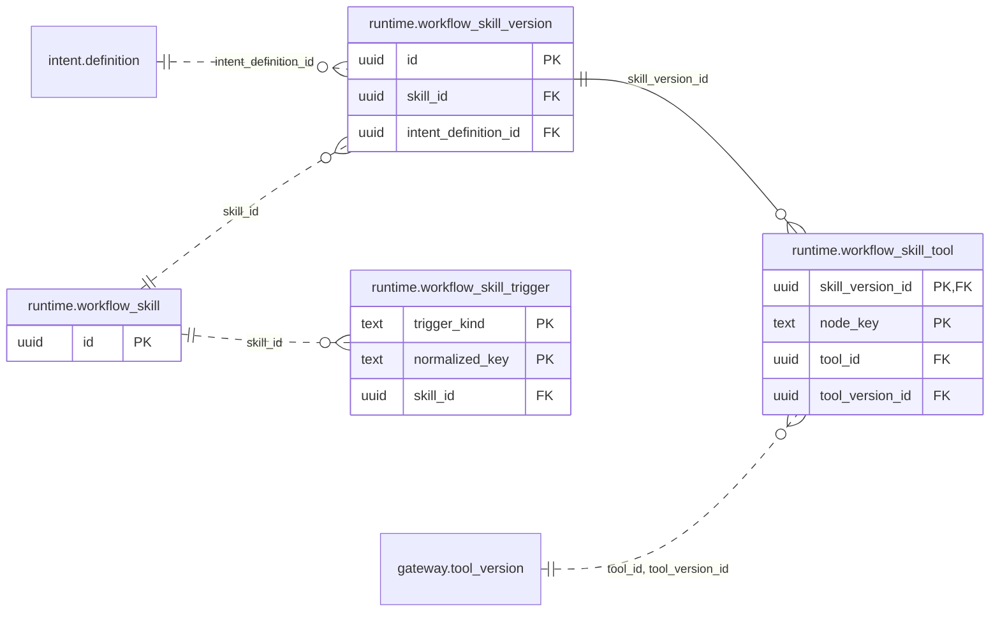
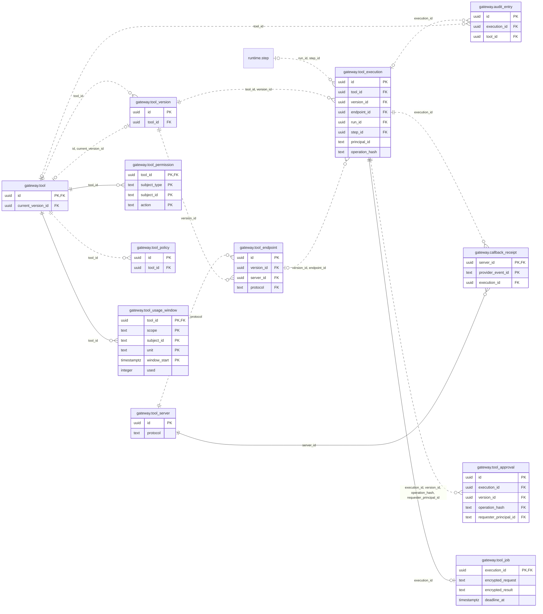
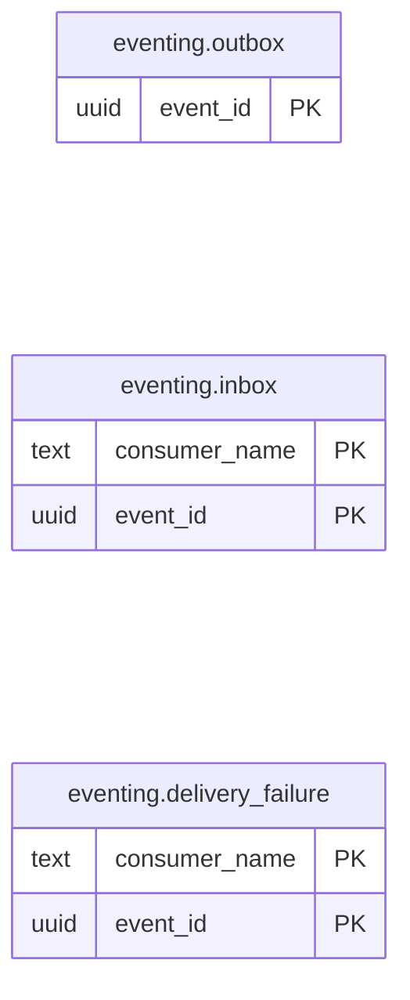
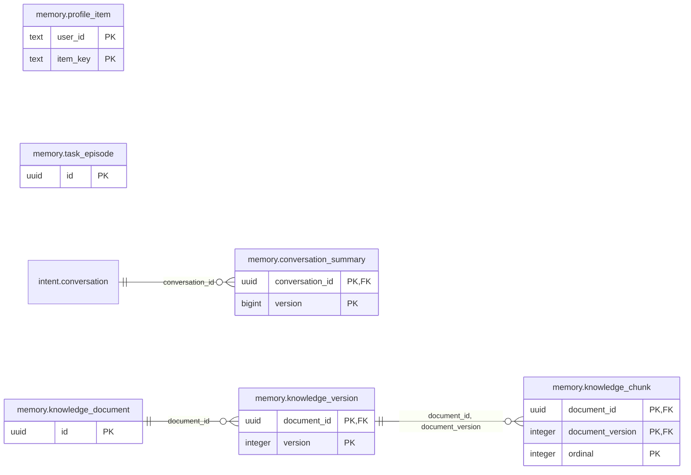
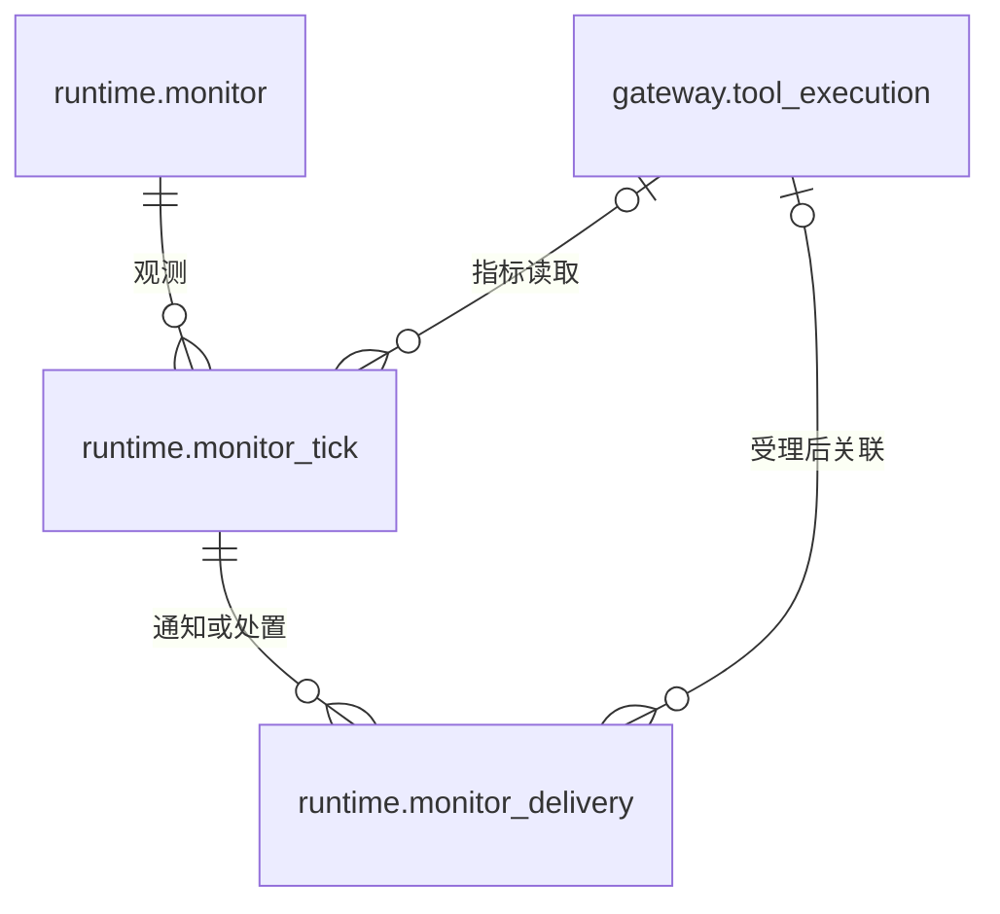

# 数据库实体关系图

先看总览，再看各域 ER。实体名称保留 Schema。图中省略重复展示的租户键和少用字段，完整复合键、约束及列清单见 [数据字典](dictionary.md)。源表是被引用方，边上的标签标注子表外键主要列。

## 跨领域总览

总览箭头表达业务关联。虚线表示事件信封或应用追溯，通过标识关联。以下 ER 图只画实际数据库外键。跨域小实体表示外键目标，字段见其所属章节。

## 接入与意图

## 运行编排与恢复

## SOP 和固定工作流

## 工具网关

## 事件存储

三张表独立保留。Outbox 和 Inbox 使用租户、消费方及事件标识完成关联与去重。

## 对话与长期记忆

## 监控信号、投递与工具执行

`runtime.monitor_tick` 的执行标识对应指标读取。`runtime.monitor_delivery` 的执行标识对应后续通知或处置，可能在等待审批。关联查询均带租户标识。
