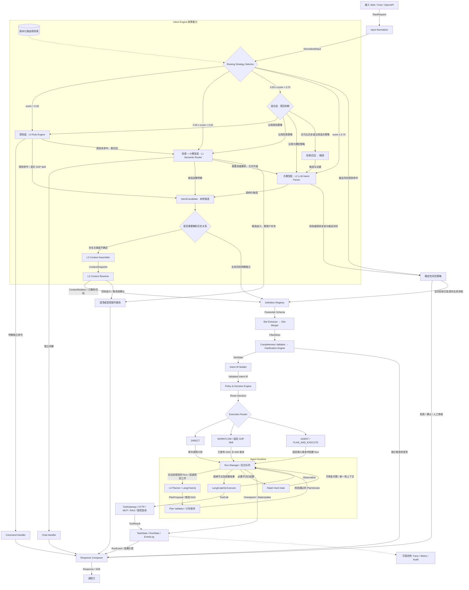

# 企业级智能助手系统架构

## 分层与产物

Routing Strategy Selector 按规则表、复杂度和可比较的历史选识别路径。规则、检索和大模型各自能产出 IntentCandidate。混合层按历史进入相应分支；没有可比历史时默认采用检索、精排和大模型判定。候选确定后，只有需要判断历史关联时才调用 Context Assembler 与 Resolver。业务候选仍须加载定义、合并槽位并通过校验，之后形成 Validated Intent IR。

| 交接产物 | 含义 |
| --- | --- |
| RawRequest / NormalizedInput | 文本、会话 ID、客户端幂等键及可选回复引用。可信租户、用户、Agent 身份由服务端认证上下文注入 |
| IntentCandidate | 当前轮的候选，支持多个候选。含领域、动作和实体线索，业务参数仍待校验 |
| ContextSnapshot / ContextRelation | 只读上下文快照与每个候选的关联结果，包含权限过滤后的目标、版本、证据和消歧需求 |
| Parameter Schema / FilledSlots / SlotState | Definition Registry 按定义版本提供 Schema，提取与合并后校验必填、格式、枚举和组合约束 |
| Validated Intent IR | 结构已校验的参数、定义版本、Task 输入版本、响应要求与风险线索。Policy Engine 另行作出服务端决定 |
| Route Decision / PlanProposal / PlanVersion | 路由记录策略版本、原因与执行模式。DIRECT 绑定单次调用，WORKFLOW 固定定义版本，AGENT 由 L4 Planner 产出候选 DAG，校验发布后才成为可执行版本 |
| ToolCall / ToolResult | 服务端注入主体、关联 ID 与工具版本。结果提供状态、结构化数据或对象存储引用 |
| StateUpdate / Response | 状态、Checkpoint 与 RunEvent 汇入运行历史。Response Composer 合并各候选结果并返回 SSE 地址或最终内容 |

图中的 AI Gateway 可作为模型接入与成本治理服务，LangChain4j 通过模型适配接口接入。本期可直接连接已选模型服务，工具请求统一经过 ToolGateway。图中的 RAG、SQL、MCP 映射为受治理能力，SQL 使用注册查询模板、参数绑定和只读凭证。可观测性横切接入、意图、运行时与网关。

## Spring Boot 模块

| 模块 | 所有权与职责 |
| --- | --- |
| access | Spring MVC、Spring Security、会话及 Turn 入口、SSE、REST 和响应组合。维护调用方鉴权与访问范围 |
| intent | L0/L1/L2 分类、L3 上下文解析、Definition Registry、槽位合并与校验、Task 和确认状态 |
| decision | 确定性策略、租户和风险门禁、意图级确认及路由。风险线索由意图模块提供，策略结论由服务端签发 |
| runtime | Run Manager、L4 Planner、Plan Validator、LangGraph4j Executor、工作队列、RunEventLog 与 Checkpoint |
| workflow-skill | 管理 SOP 清单、触发器、版本与工具绑定。发布编译快照，在 WORKFLOW 执行时提供固定 DAG |
| memory | 摘要版本、聊天提示窗口、用户档案、情节经验及知识存取。运行恢复由 runtime 所有 |
| tool-gateway | 控制平面负责注册、版本、发布和发现。数据平面负责具体工具的授权、审批、调用、防重与审计 |
| eventing | Outbox Relay、Redis Streams、Inbox、事件版本和消费隔离 |
| infrastructure | PostgreSQL、Spring JDBC / Flyway、Spring Data Redis、Secret Manager、对象存储及 OpenTelemetry 适配 |

业务模块经应用服务接口共享能力，各模块修改自有表。评审 DDL 的 intent、runtime、gateway、eventing、memory 共用 PostgreSQL 和事务管理器。API 与 Worker 独立扩缩，Worker 按模型、HTTP 工具与异步回查划分并发池。若以后拆库，跨 Schema 外键和跨模块事务需改成事件契约与补偿流程。

## L0 到 L4 按需调用

| 层级 | 归属 | 模块 | 核心职责 | 是否任务规划 |
| --- | --- | --- | --- | --- |
| L0 | Intent Engine | Rule Engine | 识别明确命令、固定格式、强约束规则 | 否 |
| L1 | Intent Engine | Semantic Router | 判定命令之外的闲聊或业务语义，召回候选并判断复杂度 | 否 |
| L2 | Intent Engine | LLM Intent Parser | 解析复杂语义、提取参数线索、拆分候选，输出 Draft Intent IR | 否 |
| L3 | Intent Engine | Context Resolver | 结合 Assembler 快照，判断本轮业务候选与原任务的关系 | 否 |
| L4 | Agent Runtime | Runtime Planner | 将通过准入的开放目标拆成 DAG，生成依赖、顺序与执行约束 | 是 |

L0～L4 是能力编号。每个新 Turn 会重新识别，可按输入直接命中、跳过或组合部分能力。L0 的确定性命令可直接交给受控 Handler，L1 的独立闲聊可走 Chat Handler。简单订单查询可由 L0/L1 识别，直接做业务定义校验与策略判断。遇到「改成华东」或「订单号是 SO001」时，根据关联信号进入 L3。复杂语句按需走 L2，再按候选进入 L3。L2 提取的草案经关系解析或明确独立判定、定义加载、槽位合并和确定性校验后成为 Validated Intent IR。只有路由选择需要动态编排的 AGENT 执行方式，才在 Run 内调用 L4。DIRECT 或固定 WORKFLOW 可以异步执行，所需流程由路由或已发布定义给出。

识别策略使用四档归一化复杂度。低于 0.30 用规则，0.30 到 0.50 前用检索和小模型，0.50 到 0.70 前为滞回，达到 0.70 用大模型。滞回延续可比较的识别策略，无历史时检索、精排并用大模型辅助。确定命令可短路，已识别的极高风险走确定性策略。复杂度决定识别方式，匹配置信度决定候选是否可采纳，业务准入与执行方式另行决定。[识别路由与四档策略](routing.md)

### 按请求类型选择执行模式

| 请求类型 | 示例 | 按需能力 | Runtime 执行模式 | 是否调用 L4 Planner |
| --- | --- | --- | --- | --- |
| 闲聊 | 你好 | L0/L1 快速识别，按需读取对话窗口 | Chat LLM | 否 |
| 简单查询 | 查询订单 SO001 | Intent Engine 按需用 L0～L3 | DIRECT | 否 |
| 固定业务流程 | 申请订单退款，或点击已注册的 SOP Skill | 明确 Skill ID、命令或固定规则走 L0；自然语言按需用 L1～L3 | WORKFLOW | 否 |
| 复杂开放任务 | 分析销售下降原因 | Intent Engine 按需用 L0～L3，准入后交给 Runtime L4 | PLAN_AND_EXECUTE | 是 |
| 动态探索任务 | 研究竞争对手并制定策略 | Intent Engine 按需用 L0～L3，准入后交给 Runtime L4 | PLAN_AND_EXECUTE，可按新证据修订 | 是 |
| 需要持续自主决策的任务 | 持续监控指标并根据异常采取措施 | Intent Engine 先解析监控目标、触发条件和权限；复杂处置时用 Runtime L4 | Agent Loop，复杂处置触发 PLAN_AND_EXECUTE | 条件触发，扩展 |

业务路由先看目标是否能映射到已知单步或已发布流程，再看是否需要根据中间结果动态拆解。Policy Engine 根据已验证目标和权限决定准入。耗时、语句长度或出现多个意图只影响解析和运行方式，Planner 的调用条件是目标需要动态编排。若同一 Turn 既查订单又研究竞争对手，两项候选分别走 DIRECT 和 PLAN_AND_EXECUTE。

持续监控的扩展模式用定时器或业务事件唤醒，平时持久化订阅状态和下一次触发点。正常指标只记录或通知。确定性响应由策略选择固定流程；需要制定处置方案时，启动一次有时间、次数和权限上限的 PLAN_AND_EXECUTE Run。首期 `AGENT` 路由承载单次动态 Run，持续监控的订阅和 Agent Loop 不纳入首期实现范围。

## 意图理解与多轮处理

每个已接收的 Turn 都有一次独立分类过程。网络重送按原 Turn 回执恢复，已持久化的候选按序号复用。L0 处理确定命令，L1 轻量语义召回，L2 按需用 LangChain4j 输出结构化候选。需要关系判断时进入 L3，独立闲聊走轻量对话处理。潜在的澄清回复、取消或确认仍进入关系判断。

Assembler 读取同一租户、同一会话且调用方可访问的最近消息、历史意图、活跃任务、输入版本、待澄清记录及相关 Run。按需拉取、限制条数与敏感字段，使用 PostgreSQL 一致读获取状态和版本，查询事务结束后才调用模型。Redis 可缓存候选 ID 或摘要，写入前读取权威状态。

对话上下文采用滑动窗口和版本化摘要。运行上下文采用对象卸载和结构化 Checkpoint 恢复。用户档案、情节记忆和语义知识按场景从各自 Store 读取，授权状态不会由摘要或历史案例决定。[记忆系统与入出库策略](memory.md)

Resolver 先评估显式目标 ID 或回复引用，再按 Domain/Action、待填槽位、状态、时序和语义筛选。复杂时让模型从候选集合内建议关系与证据，服务端复核候选范围、目标唯一性、状态和权限。有冲突时生成独立的目标消歧记录。每个候选有一条关系，`MULTI_INTENT` 体现为一轮多候选。

| 关系 | 应用动作 |
| --- | --- |
| NEW_TASK | 新建 Intent 和 Task，使用当前发布的意图定义 |
| CONTINUATION | 关联原任务，按同一意图定义补充槽位，关闭或替换待澄清记录 |
| MODIFICATION | 未启动任务追加输入版本并使旧确认失效。已排队、在跑或已完成的任务派生后继 Task，复用获准读取的结果引用。原 Run 按显式取消流程处理 |
| CANCEL | 校验唯一目标、操作者与当前状态，再向 Task 或 Run 发出取消命令 |
| CONFIRM | 校验确认 ID、主体、输入版本、操作摘要和有效期，再重新评估策略 |
| AMBIGUOUS | 记录候选目标并向用户追问，同行独立候选继续处理 |

例如「订单号是 SO001，质量问题。另外查客户 C002」产生两个候选。退款候选补齐原 Task 的退款参数并进入审批路径，客户查询候选新建 Task 并可直接运行。每个候选单独提交。候选写入业务状态时核对 task revision 与澄清状态，冲突后读取最新上下文并重判。若同一轮两个候选修改同一任务，按输入顺序提交；有矛盾时消歧。

## 执行模式和框架边界

| 模式 | 设计 |
| --- | --- |
| DIRECT | 简单、低风险且能在入口预算内完成的调用可内联领取并同步返回。内联首先创建 Run 和单步计划，超预算返回可追踪的 Run |
| WORKFLOW | 加载已发布的 Skill 编译 DAG 或内置流程定义，Run 固定定义版本。节点可等待审批、异步工具或计时器 |
| AGENT | 复杂目标才调用 L4。LangChain4j 生成 Plan DAG，服务端检查无环、节点数、工具版本引用、数据范围、依赖和运行预算后由 Executor 执行 |

LangChain4j 用于分类、结构化抽取、关系辅助、规划与响应。LangGraph4j 用于单次有界的图驱动和节点执行，外层 Run Manager 负责跨进程耐久调度。Run Manager 依据 PostgreSQL 批准有资格的节点，图节点返回 Observation 或等待结果，Checkpoint 记录可恢复位置和观察数据。每个 Run 固定图定义版本及 thread key；恢复先读业务状态、有效计划和已完成节点。首期在平台事务内保存恢复快照，图框架的自动保存模式在编码时以兼容性用例确定。若将来接入具有自带 Planner 的 Agent，同一 Run 由一个 Planner 维护计划。

复杂 AGENT 可启用 Ralph 循环，基于 Fresh Context 请求 L4 Planner 修订计划，由 Hard Gate 判定交付。重规划先停止派发旧计划的新节点，结清在途操作、审批与外部结果后切换版本。新计划复用可验证的已提交结果，已完成的副作用按操作键保护。运行时按租户配置截止时间、节点数、迭代次数、模型调用预算和并发上限。[复杂任务编排](planner.md) · [Ralph 流程](eventbus.md#ralph-循环)

企业可在 `SKILL.md` 中维护业务 SOP、参数、DAG、工具绑定及策略要求，审核后发布机器可执行的版本。显式触发走 L0，语义召回和补参可按需用 L1～L3。选中已发布定义后，执行器加载固定 DAG；具体 MCP 或其他工具节点通过 ToolGateway 复核权限、审批和版本。[SOP Skill 设计](skills.md)

## ToolGateway 治理

控制平面保存工具、已发布版本、JSON Schema、协议端点、凭证引用、权限和策略。已发布契约和路由配置按版本固定，当前发布版本可切换或回滚，发现只返回授权主体可见的已发布候选。首期用关键字与规范名称，后续再启用混合召回、RRF、重排与 Milvus。发布、停用与权限变更通过 Outbox 通知索引及缓存。

数据平面执行顺序为认证、版本解析、RBAC、ABAC、权威 Schema 校验、幂等记录预占、限流与配额、审批、分配执行租约、获取凭证并调用 Adapter、结果校验与脱敏、审计。幂等预占会固定请求摘要和版本，重复请求返回原执行记录，匹配的终态结果仍需授权。每次实际派发和审批恢复重新校验主体、工具版本状态、当前权限和摘要。停用只阻止新派发，对在途执行按下游能力取消或继续核对结果。

HTTP Adapter 首期落地。MCP Adapter 复用发现、授权和执行管道，远程 Schema 和描述进入审核发布流程，端点与 Secret 由管理员配置。gRPC、RAG、查询模板和隔离执行环境可按同一接口扩展。日志和消息仅传递关联 ID、版本、受控摘要和结果引用。

## 分阶段验收

| 阶段 | 可验收场景 |
| --- | --- |
| 基础闭环 | 按层产出中间对象，同一轮既补旧任务又启动新查询。用一个 SOP Skill 验证确定性触发、版本固定、分支与工具权限 |
| 首期长任务 | 报表提交返回 Run ID。实例重启和重复事件后可恢复。审批和取消并发有单一决策。SSE 重连可补发状态 |
| 扩展与规模化 | 检验 MCP、混合发现和管理界面，按吞吐量扩展 Worker 和 Streams 分片。需要跨团队长周期事件保留时可扩展 Kafka |

框架资料：[LangChain4j Spring Boot 集成](https://docs.langchain4j.dev/tutorials/spring-boot-integration/) · [LangGraph4j](https://github.com/langgraph4j/langgraph4j) · [LangGraph4j 与 LangChain4j 集成](https://github.com/langgraph4j/langgraph4j/tree/main/langchain4j)
