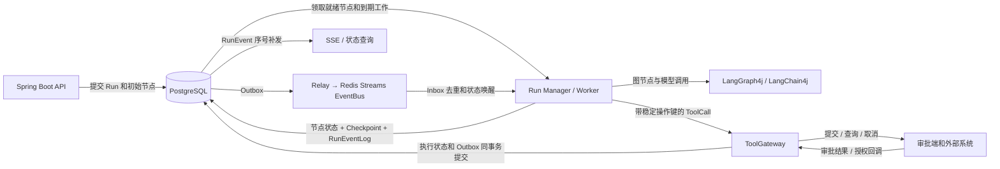
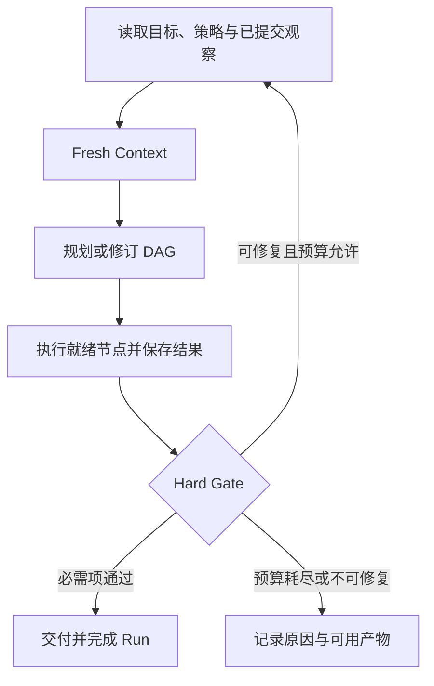

# EventBus 长任务与故障恢复

当前已实现销售分析的结构化长任务入口和独立 Worker，并接通 ToolGateway、Ralph、Redis Streams 与 SSE。下文还包含通用 SOP、事件留存、回调和人工对账的目标设计。[当前实现和联调](../docs/implementation/agent-runtime.md)

任务提交后返回 `202 Accepted` 和 `runId`。客户端可以关闭页面，执行由独立 Worker 继续。审批、外部任务和重试等待期只保留数据库状态与唤醒条件。恢复时从对应节点和观察结果继续。

EventBus 服务于耗时的 WORKFLOW 和 AGENT，也能接续超过同步预算的 DIRECT。仅动态编排的 AGENT 在运行时启动 L4 Planner。断点续跑用结构化 Checkpoint 和对象引用加载必要上下文。[L0～L4 分层](architecture.md#l0-到-l4-按需调用) · [上下文卸载与恢复](memory.md#上下文卸载加结构化恢复用于断点续执行)

四档复杂度和滞回用于接入后的识别。恢复已接纳的 Run 时读取已绑定的准入决策、输入版本和有效计划；如果继续派发或恢复工具审批，应复核实时权限和取消状态。只有业务事件、Gate 失败或用户新 Turn 等明确输入才触发相应的重规划或新路由。[识别路由与模型调用](routing.md)

SOP Skill 的 WORKFLOW 复用相同的排队、审批等待和断点续跑。恢复时载入该 Run 固定的 SkillVersion 与 DAG。已发布新版只影响之后的默认触发，Skill 或工具停用时按策略拦截新派发。[SOP Skill 设计](skills.md)

## 组件与数据流

- **Run Manager** 是 Run 和节点状态的唯一写入方。ToolGateway 拥有调用、审批和下游事实。恢复时，消费者以 Gateway 的当前持久状态决定业务迁移。
- **PostgreSQL** 保存可执行队列、计划、状态、定时唤醒和事件。API、Worker 和定时扫描都可从持久化状态推进。Redis 中断时，已落库的待执行工作可被扫描，跨模块结果可由对账追回。
- **Redis Streams** 传输已提交的领域事件，用来加快唤醒、同步索引和对接订阅方。每个事件携带聚合版本。消费者容忍延迟、重复和乱序。
- **RunEventLog** 保存用户可见进度与业务审计引用，支持 SSE 增量读取。恢复执行读取状态、节点和 Checkpoint，贴图中的事件溯源能力首期用于追溯和进度回放。全量事件重建状态可单独评估。

## 以销售分析为例

1. 用户请求分析本年度销售下降并生成次年方案。Policy 允许后，事务写入 Task、Run、引导计划、初始规划请求、`run.accepted` 和 Outbox。API 返回 Run ID、状态和 SSE 地址。
2. Worker 领取规划请求。L4 Planner 通过 LangChain4j 生成 PlanProposal，Plan Validator 校验后由 Run Manager 发布新 PlanVersion。图先准备数据快照，再并行分析地区和产品，汇合后生成报告。数据分析节点只有在所需数据就绪时才开始。[L4 Planner 与复杂任务编排](planner.md)
3. 数据导出工具接受异步请求，返回 `externalJobId`。Gateway 记为 `WAITING_EXTERNAL`。编排节点持久化该工具执行 ID 后释放租约，Gateway 按回查时间领取短任务。经认证的回调可以提前写入结果。
4. 若数据范围需要审批，Gateway 原子写入 `WAITING_APPROVAL` 和审批行，Runtime 关联执行 ID 并保存快照。审批通过后 Gateway 返回 `QUEUED`，实际派发前复核当前权限、租户、版本、参数摘要、有效期和取消标记。拒绝、失效或撤权均产生明确结果。审批事件触发回查，工具执行结果才解除节点等待。
5. Worker 读取工具终态，事务内提交 Observation、已完成节点、Checkpoint、可运行后继节点及用户事件。若首版报告缺少产品维度的证据，Hard Gate 记录失败项。Ralph 下一轮用最新结果重新组装上下文，只补缺失分析，再验证完整报告。报告存入对象存储，运行结果只记录授权引用。客户端通过 SSE 获取进度和报告链接。

应用先将稳定 operation key 写入节点，再调用 Gateway；Gateway 在请求下游前预占 execution ID 与幂等记录。若 Gateway 响应丢失，Runtime 使用相同幂等键找回 execution ID，或通过状态接口查找。审批或外部回调先于节点挂起时，Runtime 在记录关联后立即查询当前状态，定时对账补齐遗漏。

## Ralph 循环

- **Fresh Context** 每轮从固定的目标和输入版本、当前权限与预算、有效计划、已提交观察、上轮失败项及产物引用组装。并行节点上下文限定到各自的依赖输入。使用当前数据库快照，保留证据与数据版本，控制模型输入大小。
- **Hard Gate** 固定在 Run 的评审规则版本下。用确定性检查核对必要节点、Schema、依赖的数据版本、报告结构与证据引用、未决审批和外部结果。主观质量如需验收，使用有记录的人工决定。模型自评可以提供线索，最终通过条件由检查器或指定审批人判定。
- 每轮读入的快照摘要、计划版本、预算使用、Gate 检查 ID、结论与证据均可追溯。只有 `PASS` 可提交需要 Ralph 的 Run 成功；`RETRYABLE_FAIL` 在预算内创建下一轮；`TERMINAL_FAIL`、反复无进展、超限或取消按运行状态机结算。预算至少包含迭代上限、总时长、模型调用与节点数，实际阈值由租户策略配置。
- 同一 Run 只有一个有效迭代。初始迭代可先关联引导计划，在正式计划发布时同事务更新关联。每轮一旦开始验收就固定计划，检查项绑定待交付产物版本或摘要。Run Manager 串行提交 Gate 结果、预算变更、计划切换与下一轮入队。等待审批或外部结果时挂起当前迭代，恢复后继续验证。完成且有副作用的操作由稳定 operation key 和已提交结果保护。

## 状态与控制

| 对象 | 主要状态与转换 |
| --- | --- |
| Task | `COLLECTING_INPUT → WAITING_CONFIRMATION / READY → EXECUTING`，随 Run 到达 `COMPLETED / FAILED / CANCELLED`。存在对账问题的 Task 继续挂在原 Run |
| Run | `QUEUED → RUNNING`，仅在无可运行或在途节点时汇总为 `WAITING_APPROVAL / WAITING_EXTERNAL / WAITING_RETRY`。用户取消进入 `CANCEL_REQUESTED`。存在不确定副作用时进入 `NEEDS_RECONCILIATION`。最终为 `SUCCEEDED / FAILED / CANCELLED` |
| Step | `PENDING → READY → RUNNING`，可进入审批等待、外部等待或 `RETRY_WAIT`。等待结果确认后提交完成或进入下一次安全尝试。终态为 `SUCCEEDED / FAILED / CANCELLED / SUPERSEDED / SKIPPED`。条件分支未激活时记为 `SKIPPED`，结果不确定时进入 `NEEDS_RECONCILIATION` |
| ToolExecution | `QUEUED → RUNNING → SUCCEEDED / FAILED`。可等待审批、外部系统和重试。取消请求在途时为 `CANCEL_REQUESTED`，无法确定下游结果时为 `UNKNOWN` |
| ToolApproval | `PENDING → APPROVED / REJECTED / EXPIRED / CANCELLED`，具体裁决与执行状态变化同事务保存 |

Run 由当前有效计划和开放规划提案汇总。初始提案排队或运行时，即使业务 DAG 尚无节点，Run 也处于排队或运行状态。存在可运行、在途或可自动对账的工作时仍可推进合法独立节点。多种等待并存时，响应列出全部阻塞原因，主状态按审批、外部、重试的顺序展示。节点失败时停止依赖它的后继并结算分支。Run 成功要求当前计划的必要结果已落库，失败要求无未决副作用。遇到未知副作用时可暂停新派发并继续对账。所有状态判断均以事务内的行锁或版本条件为准。

### 租约和重试

领取就绪工作使用短事务与 `FOR UPDATE SKIP LOCKED`，递增 `lease_epoch` 并记录 owner、截止时间和 attempt。外部调用在事务结束后执行。心跳与提交结果在同一 epoch 下条件更新，旧 Worker 的迟到写入不生效。租约到期后按节点类型和执行状态恢复。Run Manager 用独立租约驱动步骤，Gateway 对物理调用和回查有自己的租约与栅栏。

| 失败场景 | 恢复动作 |
| --- | --- |
| API 在提交后断开 | 相同提交幂等键查回原 Turn 和 Run，参数指纹不一致时返回 409 |
| Relay 在 XADD 成功后崩溃 | 同一 event ID 可以再次发布，消费端通过 Inbox 去重 |
| Worker 在提交结果前失联 | 租约过期后检查持久化调用和结果。纯计算可重跑，已成功结果复用 |
| 下游超时且可安全重试 | 使用同一操作键、相同版本与参数，按指数退避、抖动和限额等待 |
| 下游写入结果未知 | 通过请求 ID、外部 Job ID 或业务引用查询。无法确认时 Gateway 标记 `UNKNOWN`，Run 进入 `NEEDS_RECONCILIATION`，由有权人员核对 |
| 迟到回调或事件乱序 | 按执行 ID 读取当前状态，检查提供方事件 ID 与状态版本；不逆转已确认终态，冲突保留审计记录 |

下游支持幂等时传递稳定键。仅当操作已确认未发生或下游具备相同键防重能力且契约允许时，才可重试副作用调用。工具调用幂等键覆盖一次逻辑操作的所有尝试，审批、回调和事件重投均复用该操作。

### 取消和截止时间

取消命令携带幂等键，事务内锁定 Run，与派发申领竞争；已标记取消的 Run 停止领取新的执行节点，但允许回查和收尾。排队步骤和未决审批直接关闭，进行中的外部任务按工具契约请求取消。已经授权派发的调用仍可能在网络上完成，必须核对下游结果。确认无在途副作用后才标为 `CANCELLED`；若已有无法回滚的结果，响应列出已发生的操作。无法核实的进入 `NEEDS_RECONCILIATION`，截止时间到达同样先结算在途结果。补偿动作须有已定义策略，作为可审计操作另行执行。

## 投递契约

| 事件 | 聚合与用途 |
| --- | --- |
| `run.accepted`、`run.state_changed`、`run.finished` | Run，供编排唤醒或外部进度订阅 |
| `run.step_changed`、`run.plan_changed`、`run.gate_evaluated` | Run，供进度投影。RunEventLog 保存完整的用户可见序号 |
| `tool.approval_decided`、`tool.execution_changed` | ToolExecution，供 Runtime 唤醒、结果确认和审计 |
| `tool.version_published`、`tool.disabled`、`tool.permission_changed` | ToolDefinition，供 Discovery 索引和缓存失效 |
| `skill.version_published`、`skill.disabled` | WorkflowSkill，供触发与发现缓存失效 |

事件信封包含 `eventId, eventType, schemaVersion, tenantId, aggregateType, aggregateId, aggregateVersion, occurredAt, traceId, correlationId, causationId, payload`。Redis Streams 使用 `agent:events:run`、`agent:events:tool-execution`、`agent:events:tool-registry` 和 `agent:events:skill-registry`，按消费者职责建立独立 consumer group。并发发布和消费可带来乱序，聚合版本与权威状态回读防止旧事件覆盖新状态。同一事务的事件可共用聚合版本，去重按 event ID。事件只装受控摘要和 ID。

Outbox 和业务状态同事务落库。Relay 分批领取，执行 `XADD` 成功后标记已发布。租约失效可重领，发布失败按到期时间退避。消费者通过 `XREADGROUP` 读取，在同一数据库事务插入 `Inbox(consumer_name, event_id)` 并完成业务写入，提交后 `XACK`。使用 `XAUTOCLAIM` 接管超时 pending。需要外部调用时先建持久工作，再由 Worker 调用。重试耗尽后将原事件 ID 与失败信息持久化并确认流消息，修复后按原 ID 重投。

Streams 保留窗口应覆盖消费延迟，并监控 group 积压和 pending 最旧时间后再裁剪。Redis 故障转移可能丢失已确认写入，恢复可从保留的 Outbox 按原 event ID 重放，索引可从控制平面重建，执行状态由定时对账补齐。Outbox 与 Inbox 保留窗口覆盖可重放期。工具可在后续引入 Kafka 跨团队订阅，现有事件信封复用。

SSE 先鉴权再从 `run_event` 按 per-run `seq` 补发，Streams 用于实时通知唤醒。客户端持久保存 `Last-Event-ID`，按序号去重。服务端发送心跳并定时从游标读库。若游标已过保留期，返回 410 和快照地址。客户端从快照的 `eventSeq` 重新订阅。任务结果使用授权查询并按需换取短期下载 URL。

监控项包括排队时延、续租失败率、过期租约、Outbox 最老未投递时间、Streams 消费积压、待审批时长、超期回查、未知副作用数量、Gate 失败原因和 SSE 重连。设计验收覆盖提交后断连、重复投递、Worker 崩溃、回调提前、审批与取消竞态、凭证撤销、Ralph 修订与超限及 SSE 回放。
