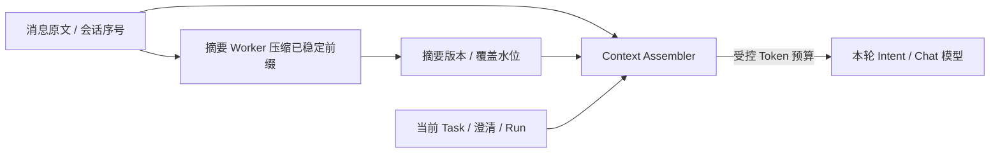
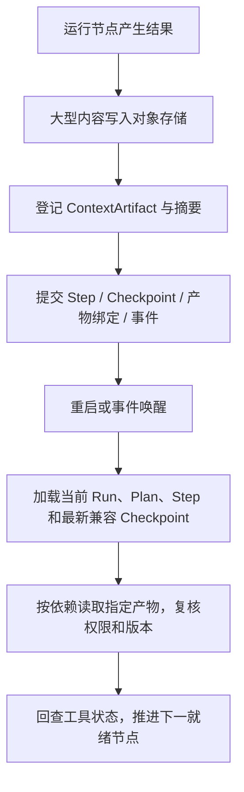

# 记忆系统与持久化设计

本方案把记忆按用途分为请求临时上下文、会话历史、任务运行状态和跨任务知识。**首期交付会话记忆、对话记忆和工作记忆。** 用户档案、情节经验、语义知识的库表也已给出评审草案，启用时间按业务数据来源和权限配置决定。历史方案已有消息、任务、Run 和 Checkpoint，本次补上明确的消息序号、滚动摘要、上下文卸载登记和跨任务记忆表。

## 六类记忆一览

| 能力 | 作用和生命周期 | 权威持久化 | 热路径与读取键 | 设计范围 |
| --- | --- | --- | --- | --- |
| Session Memory | 当前连接、选中文件、临时 UI 草稿。请求或连接级，允许按 TTL 跨短暂断线 | 请求级变量放 JVM。跨实例临时状态用 Redis TTL；用户保存草稿时转成业务记录或对象 | 认证后以租户、用户、session ID 查 Redis | 首期临时能力，建议初始闲置 TTL 30 分钟 |
| Profile Memory | 用户明确批准的偏好或权威系统事实。跨会话长期 | `memory.profile_item`，以来源和版本管理 | 精确键 `tenantId / userId / itemKey`，Redis 可缓存允许的偏好 | 扩展 |
| Working Memory | Task 当前参数、Run 的执行位置、节点状态和中间结果。任务期内短期使用，必须跨重启持久化 | `intent.task`、`task_input`、`clarification`、`confirmation`、`runtime.run`、`plan`、`step`、`checkpoint`；大型内容放对象存储 | 按任务或 Run ID、`graphThreadKey` 和 Checkpoint 序号读取，活动状态以数据库为准 | 首期 |
| Conversation Memory | 当前会话的原始消息、滚动摘要和热窗口。检索限于会话，原文按租户留存 | `intent.conversation`、`turn`、`message`、`memory.conversation_summary`。消息和摘要正文走受控内容存储 | 同租户会话按 `seq` 读最近窗口和有效摘要。Redis 可缓存热窗口和摘要 | 首期 |
| Episodic Memory | 过去成功案例中可复用的方法。跨会话或跨任务长期 | `memory.task_episode` 保存来源、范围、版本和脱敏案例引用 | 按场景关键词或语义检索，先按租户、可见范围和版本过滤，再回读权威记录 | 扩展 |
| Semantic Memory | 长期领域知识、政策文档、API 文档和业务知识库 | `memory.knowledge_document / knowledge_version / knowledge_chunk` 与源文档对象 | 关键词或向量召回后按权限、有效文档版本复核，返回证据和引用 | 扩展，通常经受治理的 Retrieval Tool 调用 |

工作记忆的「短期」指它服务一条任务生命周期。即使某个 Run 等待审批数天，它的状态仍需持久化。会话历史的「当前」指它按会话隔离，旧会话可在留存期内查看。长期跨会话记忆只通过 Profile、Episode 或知识库按权限读取。

## Store、Saver、缓存和事件分别做什么

| 机制 | 读取方式与职责 | Java 方案 |
| --- | --- | --- |
| **Store** | 按命名空间、键或搜索条件读业务事实与内容，例如 `tenant / user / profile` 或 `tenant / knowledge / collection` | Spring Boot 的 Profile、Episode、Knowledge Repository 和内容读取服务。物理上可用 PostgreSQL 与对象存储，Milvus 提供可重建索引 |
| **Saver** | 按 Run、图线程和 Checkpoint 读取执行快照，保存可恢复位置、结构状态和产物绑定 | 首期由 Run Manager 的平台 Checkpoint Saver 持久化到 `runtime.checkpoint`，与执行状态同事务。LangGraph4j 的 `BaseCheckpointSaver` 是图框架接口，可在编码时适配。只有选定与业务事务一致的恢复方案后才启用框架持久 Saver |
| **ChatMemoryStore** | 给 LangChain4j 的模型聊天记忆组件存取当前窗口 | 若采用 LangChain4j 的窗口实现，读取或存放的是可重建的提示上下文视图。正式会话原文通过业务 Repository 追加写入 |
| **Cache / 临时状态** | Key-Value 与 TTL，快速读取，缓存丢失可回源；会话临时草稿丢失按产品定义处理 | JVM 请求上下文和 Redis KV。会话缓存包含租户、会话 ID 和版本；用户档案缓存键按租户、用户、字段和版本 |
| **EventBus / EventLog** | 按消费者组或事件序号消费变化 | Redis Streams 传输通知。PostgreSQL RunEventLog 支撑 SSE 补发与审计，Run 和 Checkpoint 支撑业务恢复 |

Java 库与参考中的 Python 名称分开理解。LangGraph4j 的 `AgentState` 表示图状态，Saver 按序列化配置保存状态。请求级身份、临时 UI 字段和凭证由 Spring 安全上下文或显式运行参数传入，避免进入可持久化的 AgentState。Python 的 `BaseStore / PostgresStore` 在这里作为长期 Store 的架构概念，方案用 Spring 服务实现隔离与数据访问。官方 LangGraph4j 另有 PostgreSQL Saver 实现，采用其方案时需要验证与 Run、Step、Checkpoint 的提交和恢复边界。 [LangGraph4j PostgreSQL Saver](https://langgraph4j.github.io/langgraph4j/1.9/core/postgres-saver/) · [LangChain4j Chat Memory](https://docs.langchain4j.dev/tutorials/chat-memory/)

## 入库、读取与更新策略

| 数据 | 何时入库 | 何时读取或出库 | 更新、过期与一致性 |
| --- | --- | --- | --- |
| 请求与连接上下文 | 入口解析后进 JVM。跨连接恢复的非敏感快照按需放 Redis | 鉴权后恢复选中文件和 UI 状态。文件本身需重新授权 | 每次有效变更更新；退出登录或会话 TTL 到期清理；安全主体每次重新认证 |
| 原始聊天消息 | 用户消息与 Turn 受理同事务写元数据。助手回复在回执提交时追加，后台进度写 RunEventLog | 前端历史按游标分页；Context Assembler 在分类、消歧或组织回复时读相关消息 | 按会话分配单调 `seq`；只在业务删除或脱敏时修改可见性，保留期到达后清理正文与派生摘要 |
| 滚动摘要 | 窗口超预算且可压缩前缀扩大时异步生成，有需要时模型调用前触发。内容写好后提交 `summary_ref` 与水位 | 模型请求前读同一历史代次下的最新有效摘要，按覆盖水位拼接未覆盖消息 | 追加摘要版本；以会话锁和历史代次防止旧任务回写。原文更正或删除时提升 `history_revision`，失效缓存及旧摘要，按有效原文重建 |
| Task / Run / Checkpoint | 接收业务动作、补参、计划发布、节点提交、等待审批、外部任务接续和结束等业务边界提交 | L3 按授权读 Task 和未完成状态。Worker 起跑、租约恢复、审批恢复、Ralph 下一轮读取有效状态 | Task 用输入版本与 revision；节点用租约与版本推进。Checkpoint 按提交时序追加，终态后按策略保留必要恢复点和审计记录 |
| 大型输入与产物 | 获取稳定数据快照、大型工具结果或报告时写不可变对象，同时在业务事务登记引用和摘要 | 仅需要该依赖的节点、恢复工作或授权下载加载指定版本，校验摘要 | 每次有效变更写新版本；按引用和业务保留策略清理。活跃 Run 所需的产物持续可读 |
| Profile Item | 用户明确确认写入、管理员维护或权威系统同步 | 会话入口或相关节点按白名单取需要的字段，例如语言偏好 | 同键按来源优先级和 revision 更新，提交后失效缓存；用户撤回或过期后停止注入。高敏字段按目的和权限读取 |
| Task Episode | Run 成功后由 Outbox 触发候选提炼；如启用 Hard Gate，要求已通过。审核、脱敏并批准范围后激活 | Planner 规划前按场景查少量相似案例，再核对来源范围和当前工具版本 | 源 Run 唯一，订阅重投可幂等。按 revision 更新索引；撤销时禁止读取，清理异步索引 |
| Knowledge | 文档进入登记、分块、校验、发布流程。权威源内容和版本先持久化，索引异步构建 | 明确需要领域知识时，通过检索节点或工具查有效版本和片段，返回证据引用 | 按不可变版本发布，数据库配置决定当前生效版本。旧版本撤销后跳过陈旧索引命中，向量可重建 |

PostgreSQL 是业务元数据、状态和版本的权威源。Redis 读取失败时回源，授权和有副作用的恢复决策直接读取当前业务状态。向量索引过期时读取结果仍要经过数据库权限和版本复核。对象内容先写到私有不可变路径，提交数据库引用后才可见；失败事务遗留的暂存对象按批次或时限回收。

四档识别策略的短期历史存于 `intent.routing_assessment`。仅在当前分落在滞回区间且同一比较范围仍适用时，读取上一轮的策略；Redis 可持有该记录的短期镜像。记录只包含审计需要的策略和原因，随会话路由审计策略归档，长期档案与情节 Store 无需写入。[滞回及读取条件](routing.md#滞回如何稳定路由)

组织发布的 SOP Skill 归业务定义注册表。原始 `SKILL.md` 和编译版本长期保存用于版本治理；触发映射可短期缓存。在补参和续跑时分别读 TaskInput 与 Plan 固定的 Skill 版本，当前发布版本和缓存只帮助新请求发现。[SOP Skill 注册表](skills.md#注册表与运行记录)

## 滑动窗口加摘要用于聊天历史

1. **完整会话历史单独保存。** 分配当前会话 `seq`，并且只在该租户保留期内读取正文。应用按可用 token 和最多消息数设置滑动窗口，优先保留本轮输入、近几轮完整消息及与当前问题相关的引用。
2. **将窗口之外的稳定前缀压缩。** 一份摘要覆盖到 `covered_through_seq`，例如 32。生成时取历史代次、上个摘要和新增前缀，保存摘要版本、覆盖水位、来源摘要值与生成器版本。复制订单号、授权信息等精确事实时需要引用原记录。活跃任务的完整参数继续从 TaskInput 和 Clarification 读取。
3. **拼接且消除重复。** 正常读取当前有效摘要，加上序号大于 32 的原文后缀。若后缀太长且摘要任务滞后，优先保留最新完整消息，按需读取目标引用或同步压缩必要片段。缺口体现为上下文不足，必要时追问。检查缓存对应的消息序号与历史代次，删除失效的摘要版本。

LangChain4j 的窗口组件可按消息数或 token 数裁剪给模型的内容。框架窗口驱逐也会影响其 ChatMemoryStore 里的消息，所以平台保留独立的消息历史 Repository。摘要内容按业务上下文使用，原始输入和模型摘要均遵守权限边界。 [LangChain4j Chat Memory](https://docs.langchain4j.dev/tutorials/chat-memory/)

## 上下文卸载加结构化恢复用于断点续执行

**卸载**把大型工具原始 JSON、快照、文件和观察结果放在受控对象存储。在 `runtime.context_artifact` 保存类型、版本、内容引用、校验摘要和产出节点。Checkpoint 保存小型结构状态，`runtime.checkpoint_artifact` 将结构中的绑定键映射到同一 Run 的具体产物版本。Ralph 的 Fresh Context 也可按这套引用读取本轮需要的观察，并把选材摘要写入迭代记录。

**结构化恢复**从可信 `tenantId + runId` 找到运行状态、有效计划、图版本和线程 Key，再选最新兼容 Checkpoint。核对格式，加载节点所需的产物，检查审批、下游 execution ID、操作键、租约和取消标记。已成功的节点结果复用；下游处于运行、未知或已批准待派发时按 Gateway 状态回查和结算。缺失必要产物或序列化格式不兼容时，产生可追踪的阻塞错误。活动状态查询始终以 Run、Step 和 Gateway 当前记录为准。

例如销售快照约 20 MB。数据库保存 `sales_snapshot:v1` 的真实位置与校验摘要，Checkpoint 保存当前计划、观察关系和绑定键。在外部报表等待时 Worker 重启，只需恢复 Run 与等待的 execution ID。结果确认后，下一个分析节点按需读取它的依赖文件，并且使用与其他分支一致的数据版本。对话摘要即使已更新，也不会改变此次 Run 使用的数据范围。

## 生命周期和验收

- **短期临时数据**按 Redis TTL 或请求生命周期清理。一个失效的 session 不应阻止后端继续运行。
- **任务期数据**在活跃 Run 期间及其等待、重试、对账期间维持可读。Run 终结后才按租户策略裁剪旧 Checkpoint 和无引用产物。业务运行审计的保留期可独立配置。
- **聊天历史与摘要**按租户保留期和删除请求更新；摘要、缓存和相关检索索引使用相同权限，并跟随源数据撤回。旧摘要版本保留期可短于原文。
- **长期记忆**定期按来源有效性和权限复检。Episode 保存时验证源 Run 的租户、主体和终态，并另存脱敏副本。源 Run ID 保留为追溯标识，运行记录的归档不阻塞案例保留。用户数据撤回和源权限变化时按来源关系处理案例。语义知识以文档版本和发布时间控制有效期。各持久表的实际留存天数由部署环境定稿。
- 验收覆盖窗口压缩前后上下文连续、摘要更新并发、原文删除后摘要不可见、Redis 清空回源、换实例恢复外部任务、校验失败产物不推进、Profile 跨会话准确与 Episode 或知识库跨租户隔离。
