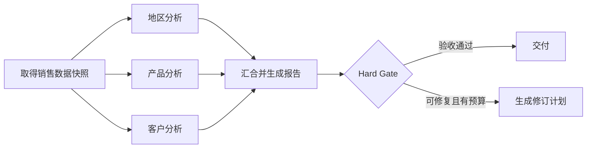

# L4 Planner 与复杂任务编排

用户说「找出今年销售额下降的原因，并生成明年的增长方案」。Intent Engine 提取分析周期、组织范围和目标，Policy Engine 检查准入，Execution Router 将复杂目标送入 `AGENT` 模式。Run Manager 先创建持久化 Run，再在后台启动 L4 Planner。Planner 要交付一份机器可校验的任务图，说明为了回答问题需要哪些数据、哪些分析可以并行、每一步依赖什么，以及最终如何产出报告。

L0～L3 属于 Intent Engine，作用是识别、理解和消歧。本页的 L4 属于 Agent Runtime，读取已验证并获准的目标。L0～L4 按需调用，固定流程或简单工具调用可直接运行各自的计划。[分层与调用路径](architecture.md#l0-到-l4-按需调用)

归一化复杂度达到 0.70 时可用大模型做识别，仍按目标决定是否调用 L4。一个表达复杂、要用 L2 提参的退款请求，在参数齐全并获准后仍可执行已发布的 WORKFLOW。识别路由的滞回也不会把原有计划移给新请求。[识别路由与执行模式](routing.md)

## 哪些请求走 Planner

| 请求 | 路由与理由 |
| --- | --- |
| 查某个订单 | DIRECT，目标和工具已知，执行单步计划 |
| 按既定流程申请退款 | WORKFLOW，按已发布的流程运行，可等待审批并长期挂起 |
| 解释销售下滑并给出增长方案 | AGENT，所需数据、分析步骤和分支取决于目标和中间结果，交给 L4 Planner |
| 研究竞争对手并制定策略 | PLAN_AND_EXECUTE，根据新证据选择或修订调查步骤 |
| 持续监控指标并根据异常采取措施 | Agent Loop 扩展，定时器或事件唤醒。当异常需要动态处置时，才启动有界 PLAN_AND_EXECUTE |

执行时长由 Run Manager 处理。耗时的固定工作流也能异步。每个候选独立路由，只有动态编排需求提交给 L4 Planner。闲聊经 Chat LLM 回应。[完整请求路由表](architecture.md#按请求类型选择执行模式)

已发布的 SOP Skill 已包含固定 DAG。单独运行时由 WORKFLOW Executor 加载版本，按已定义条件选分支。后续开放式任务也可复用已发布 Skill 作为受治理子流程，L4 只规划这个子流程在更大任务中的位置，发布时仍需校验版本、权限和输入契约。[SOP Skill 设计](skills.md)

## 谁决定哪一件事

| 组件 | 接收 | 产出与职责 |
| --- | --- | --- |
| Execution Router | Validated Intent IR、准入策略 | 带版本的 Route Decision，指定 AGENT 时创建异步 Run |
| L4 Planner | 固定的目标与输入版本、可用工具、接受标准、剩余预算、当前观察 | 通过 LangChain4j 生成结构化 PlanProposal，包含目标、节点和依赖 |
| Plan Validator | PlanProposal、服务端规则、带版本的工具契约 | 检查 DAG、输入输出、预算、权限边界和复用证据。通过后由 Run Manager 原子发布 |
| Run Manager | 有效 PlanVersion 和持久化任务状态 | 就绪队列、租约、并行控制、超时与状态推进。数据库中的节点状态是并行资格和恢复依据 |
| LangGraph4j Executor | 有效图与已领取节点的输入 | 驱动图中的受控节点动作，返回 Observation、错误或挂起信息 |
| ToolGateway | 固定工具版本、参数、可信主体和操作键 | 再次授权、审批、协议执行和审计 |
| Ralph / Hard Gate | 当前交付物、验收规则、失败证据和剩余预算 | 通过则结算成功，可修复则提交下一轮规划请求 |

## 从目标到可执行计划

1. **受理。** Run Manager 持久化 Run、固定输入版本、引导计划和首个 `REQUESTED` 提案，返回 `runId`。用户关闭页面后规划仍可运行。
2. **构造 PlannerInput。** 规划 Worker 通过提案租约领取工作。从权威状态读取目标、授权数据范围、输出要求、允许使用的工具和版本、验收规则、总时限与剩余预算。首轮重点是目标和可用能力。修订轮加入当前有效计划、已完成节点、观察结果及失败项。
3. **生成 PlanProposal。** LangChain4j 使用结构化输出，每个节点给出类型、输入绑定、直接依赖、输出契约和操作约束。工具节点引用已注册工具版本，每个工具节点只有一个可追踪的 ToolExecution。计划候选及输入摘要先持久化。
4. **校验。** 除节点 ID、依赖存在与拓扑无环外，还检查输入引用只指向已声明的依赖或合法产物、工具版本和参数类型相容、分支有汇合或终止语义、同一逻辑副作用有稳定操作键、最坏执行与重试预算有界。运行时仍以服务端授权和实际参数校验为准。
5. **发布。** Run Manager 锁定 Run，核对状态、有效基础计划和观察版本。事务内写入新 PlanVersion、节点与依赖、更新有效计划、排入根节点，并追加 Checkpoint、RunEvent 和 Outbox。结构错误可在模型预算内重新生成。若计划基础已经变化，重新组装上下文。计划无法满足前置条件时，记录拒绝原因和可采取的用户操作。

### 节点定义示例

| 节点 | 直接依赖 | 输入 | 输出 |
| --- | --- | --- | --- |
| `sales_snapshot` | 无 | 固定分析期、门店范围、销售口径 | 带版本的销售数据集 |
| `region_analysis` | `sales_snapshot` | 销售数据集版本 | 地区维度证据 |
| `product_analysis` | `sales_snapshot` | 同一销售数据集版本 | 产品维度证据 |
| `customer_analysis` | `sales_snapshot` | 同一销售数据集版本 | 客户及复购维度证据 |
| `draft_report` | 三个分析节点 | 已校验的证据引用 | 原因、增长方案及引用 |
| `verify_report` | `draft_report` | 报告版本及固定验收规则 | Hard Gate 结论和失败项 |

图中三项分析在拿到同一快照之后各自运行，汇合节点等三项必要输出都保存成功才就绪。Run Manager 按租户与模型、工具的并发限额领取。单节点执行结束后，数据库事务只更新该节点、对应观察和受影响的后继。LangGraph4j 可以恢复图状态，节点业务状态与依赖以当前计划中的持久记录为准。节点调用外部工具进入 `WAITING_EXTERNAL` 或 `WAITING_APPROVAL` 时释放 Worker，独立分支仍可继续。

## 什么时候重试，什么时候重规划

| 情况 | 下一步 |
| --- | --- |
| 产品查询有可安全重试的瞬时错误 | 原计划、原节点和原操作键重试 |
| 产品报表端点持续失败，允许使用另一份授权数据源 | L4 Planner 生成修订计划，保留已合格的地区和客户证据 |
| 报告引用了错误时间窗口的数据，Hard Gate 未通过 | Ralph 记录失败证据，启动 Fresh Context，再请求 L4 Planner 修订 |
| 退款等外部写操作结果未知 | 走对账并保留原操作键。待副作用确认后再决定是否修订剩余步骤 |
| 用户修改目标或数据范围 | Context Resolver 先处理新的用户请求。已启动的 Run 保留原输入版本，必要时派生新 Task |

修订期间 Run Manager 停止派发旧计划的新业务节点，同时回查已调度调用。已有审批按策略继续结算或撤销，确认没有未决副作用后才发布新计划。发布时将旧计划未运行节点标为 `SUPERSEDED`，保留完成记录。示例中可把地区和客户的观察引用绑定成新计划的已知输入，前提是分析口径、数据版本、权限和证据仍有效。新计划可重算产品维度并重生成报告。已提交的写操作通过操作键和结果引用复用。

一个 Run 同时只有一份有效计划和一个开放的编排提案。提案从 `REQUESTED → GENERATED → PUBLISHED` 推进，也可结算为 `REJECTED / STALE / CANCELLED`。租约过期后可重领，已生成的草案可直接进入校验。Planner 超时、提案拒绝、重规划次数耗尽分别有可追踪原因。Hard Gate 的验收阈值随 Run 固定，重规划次数、总节点数、模型调用量与截止时间由 Run Manager 控制。首期在 Spring Boot Worker 内划分规划任务池，后续可单独部署。
