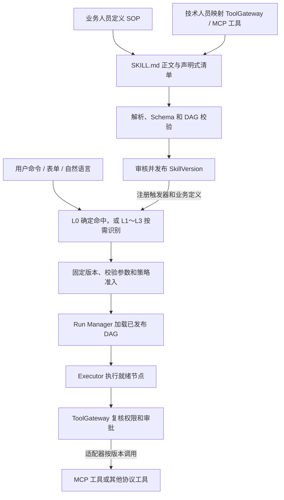

# 企业 SOP Skill 与固定工作流

企业可以把成熟 SOP 做成版本化 Skill。业务人员定义适用条件、参数、业务分支、审批与验收结果，技术人员将步骤绑定到已注册的 MCP 或其他 ToolGateway 工具，并把流程做成可校验的 DAG。发布后，系统可根据明确的命令、表单动作或 Skill ID 直接找到它。

**明确命中属于 L0，运行 Skill 仍属于 Agent Runtime。** 如果一句自然语言要先识别意图，L1 可召回 Skill，L2 可提取输入，L3 可关联历史任务。只要流程图已经固定，执行仍走 WORKFLOW。符合 DIRECT 条件的单工具 Skill 可走 DIRECT。L4 Planner 负责的是临时拆解开放目标，和加载已发布的 DAG 分工不同。

## 识别和执行的组合

| 输入场景 | 意图入口 | 运行方式 |
| --- | --- | --- |
| 表单按钮「申请退款」传入 `skillKey=order.refund` 和结构化参数 | L0 确定命中，按 Schema 校验 | 固定 WORKFLOW |
| `/refund SO001` 带明确命令但没给原因 | L0 命中，创建 Task 和澄清记录 | 补齐参数且获准后启动同一 Skill 版本的 WORKFLOW |
| 「这个商品坏了，帮我处理下」 | L1 召回退款等候选，L2/L3 按需补参或关联前文 | 确定为退款后仍走同一固定 WORKFLOW |
| 显式运行已发布的单工具只读查单 Skill，参数齐全 | L0 命中 | 满足同步预算和准入条件时走 DIRECT |
| 「找出退货升高原因并制定治理策略」 | Intent Engine 按需识别，经策略准入 | L4 规划研究步骤。已发布的 Skill 可作为获准、版本固定的能力复用 |

流程里的条件分支、并行、等待审批和失败处理可以由 Skill 预定义。DAG 有十个节点或耗时数小时，也可以由 L0 找到已有 SOP。缺参时追问，目标不明确时消歧。工具下线后按已发布的失败策略挂起或结束，需要替代流程时重新走确认和准入。

## 从 SOP 到已发布 Skill



1. **编写。** 业务人员将 SOP 写成易于审阅的正文，列出适用范围、输入、步骤、边界和异常。技术人员在同一个 `SKILL.md` 的受约束 YAML 清单中声明业务意图、参数 Schema、DAG、依赖、输入输出绑定、可用工具版本、策略引用、超时和失败分支。
2. **编译。** Spring Boot 的 Skill Registry 解析白名单字段和受限表达式，调用 Definition Registry 与 ToolGateway Registry 校验。清单中声明的输入 Schema 要与引用的意图定义版本一致。检查触发器是否冲突、图是否无环、节点是否可达、数据类型及参数绑定是否匹配、操作键和重试策略是否符合工具能力。风险、权限与审批引用必须指向已配置的服务端策略。
3. **发布。** 审核通过后生成编译快照与摘要，冻结 Skill 版本、已发布的意图定义版本、DAG 和工具绑定。同一事务更新命令、表单动作和明确别名，递增 Skill revision 并写 Outbox，驱动发现索引与缓存同步。原始 `SKILL.md` 及审核记录作为来源保留。执行器读取发布快照，按声明式节点类型调用能力。
4. **执行。** L0 可以用明确 `skillKey`、命令或固定别名命中注册表，参数以白名单字段绑定。第一次创建 TaskInputVersion 时固定 Skill 版本，续轮补参沿用同一版本。通过意图级准入后，Run Manager 把编译 DAG 复制为该 Run 的 PlanVersion，按依赖推进、挂起和恢复。
5. **变更。** 修改 SOP、Schema、节点、工具版本或策略要求时发布新 Skill 版本。新请求默认取当前发布版本。旧 Task 与 Run 继续使用已绑定的版本，`RETIRED` 版本按策略可为既有任务续跑。实际派发前核对当前启停状态、调用主体和授权。`DISABLED` 或撤权可阻断新的派发，在途写操作按现有对账和取消流程结算。

## SKILL.md 的声明式清单示意

正文可以写业务解释、操作示例与异常处理。清单表达可验证的配置，例如以下退款片段。工具和策略名均需在服务端注册。

```yaml
skillKey: order.refund
version: 3
intentDefinition: ORDER.REFUND@5
executionMode: WORKFLOW
triggers:
  - kind: COMMAND
    key: /refund
  - kind: FORM_ACTION
    key: order.refund.submit
inputSchema:
  type: object
  required: [orderId, reason]
  properties:
    orderId: { type: string, minLength: 1 }
    reason: { type: string, minLength: 1 }
admissionPolicy: order.refund.submit
nodes:
  - id: verify_order
    tool: orders.lookup@2
    inputs:
      orderId: input.orderId
  - id: submit_refund
    dependsOn: [verify_order]
    when:
      field: steps.verify_order.output.refundable
      equals: true
    tool: refunds.submit@4
    policy: refund.approval.policy
    inputs:
      orderId: input.orderId
      reason: input.reason
```

编译器把工具别名解析成同租户的 Gateway 工具 ID、版本 ID 和契约摘要。MCP 的 Server 和凭证由 Gateway 按环境管理，Skill 负责业务节点和参数绑定。清单声明权限要求、审批策略和数据范围，实际执行由 Spring Security、Policy Engine 和 ToolGateway 根据当前调用主体及参数复核。文档、向量检索结果和模型输出不具有授权效力。审批通过后仍需复核权限、版本、参数摘要和有效期。

在示例中，订单不可退款时，提交节点记为 `SKIPPED`，流程返回「订单不符合退款条件」。编译器校验汇合或后续节点只读取实际执行的分支产物。单工具 Skill 仅在满足 DIRECT 的业务和运行约束时发布为 DIRECT。

## 注册表与运行记录

| 对象 | 记录内容 |
| --- | --- |
| `runtime.workflow_skill` | 同租户唯一 Skill Key 和注册表状态 |
| `runtime.workflow_skill_version` | 定义版本、编译 DAG、源文件引用、摘要、策略引用、执行模式和发布状态 |
| `runtime.workflow_skill_trigger` | 命令、表单动作或明确别名映射到稳定 Skill ID |
| `runtime.workflow_skill_tool` | 每个工具节点固定映射到 ToolGateway 工具及版本 |
| `intent.task_input.workflow_skill_version_id` | Task 补参和准入时使用的 Skill 版本 |
| `runtime.plan.workflow_skill_version_id` | 运行计划固定的 Skill 版本，便于恢复和审计 |

首期可以先做一个显式 SOP，例如审批退款，验证命令命中、缺参追问、固定 DAG、MCP 工具调用、权限撤销以及旧 Run 可恢复。平台按实际可用 Adapter 逐步扩大覆盖范围，工具协议不会改变 Skill 的编排方式。已有内置流程也可以通过同一 WORKFLOW 执行入口运行。
