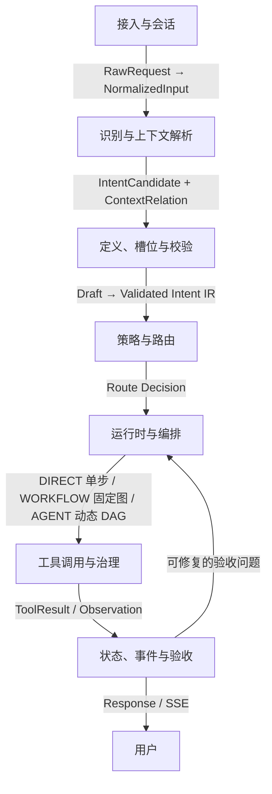

# 企业级智能助手从总体到细节

可以把整套系统理解为三个连续的问题。第一，用户现在要做什么，这句话与之前哪件事有关。第二，这件事是否允许做，应该走查询、固定流程还是动态规划。第三，如何持续运行、处理故障并把可信结果交给用户。前两个问题围绕 **Turn 和 Task**，最后一个问题围绕 **Run、Step 和 ToolExecution**。

建议先读本篇的主线，再走两组多轮例子。第一组观察一个 Turn 如何同时处理两件事，第二组观察一个复杂目标如何跨计划版本持续运行。

## 总体主线

| 名词 | 可以用什么问题理解 |
| --- | --- |
| Conversation / Turn / Message | 在哪段会话，用户这次说了什么，系统本轮回复了哪些内容？ |
| IntentCandidate / Intent | 这句话可能表达什么动作？其中哪些动作已经绑定到一个业务目标？ |
| Task / TaskInputVersion | 用户想完成哪件事？系统正在使用哪一版参数？ |
| Run / PlanVersion | 系统接纳了哪次执行？当前按照哪个计划运行？ |
| Step / ToolExecution | 计划里的哪一步在推进？它发起的工具操作是什么，是否需要审批或对账？ |
| Observation / Checkpoint / RunEvent | 节点产出了什么？进程重启从哪里恢复？前端还漏了哪些进度？ |

一个 Turn 可以创建多个 Task，也可以补充之前的 Task。Task 达到可执行条件才产生 Run。同一 Run 可以历经多个计划版本。一个工具节点可以重试多次，始终用同一个逻辑工具操作身份。这个分法使「聊了几轮」「任务是否齐参」「执行是否完成」可以各自推进。

## L0 到 L4 怎么走

| 能力 | 问题 | 产物 |
| --- | --- | --- |
| Intent Engine L0 Rule Engine | 是明确命令或固定句式吗？ | 命令或确定候选 |
| Intent Engine L1 Semantic Router | 是闲聊、常见业务需求还是复杂表达？ | 路由信号和候选 |
| Intent Engine L2 LLM Intent Parser | 具体想做什么，有几件事，提到了什么参数？ | 有结构的意图草案 |
| Intent Engine L3 Context Resolver | 这句话涉及哪个历史任务或澄清问题？ | 每个候选的关系和目标 |
| Agent Runtime L4 Runtime Planner | 对已接纳的复杂目标，需要走哪些任务步骤？ | 带依赖的候选 DAG，校验后发布 |

每轮按需要选择能力。比如 `/help` 在 L0 处理，独立寒暄可以走 L1 和 Chat。明确的订单查询可能走 L0/L1 后直接校验与准入。「订单号是 SO001」要走 L3 关联待澄清任务。「分析销售下滑并生成增长方案」才可能在准入和路由之后启动 L4。L2 的参数是草案，定义、合并和校验完成后才能交给策略层。

可以用「下一步是否已经知道」辅助判断。闲聊交给 Chat LLM，按订单号查询只需 DIRECT，退款按既定审批步骤走 WORKFLOW。分析销售下降、探索竞争对手需要根据拿到的证据决定后续步骤，走 PLAN_AND_EXECUTE。持续监控是后续 Agent Loop 能力，每次触发先判断是否需要动作，复杂异常才调用 Planner。耗时的退款仍是 WORKFLOW。[完整请求路由表](architecture.md#按请求类型选择执行模式)

有时同一个查询的说法变了，例如「查询订单 SO001」之后又说「能把这个单的状态和到货时间找给我吗」。如果识别分从 0.48 变为 0.55，第二轮处于滞回区间，可继续使用检索和小模型，但仍重新确认订单目标、字段和权限。若接着改成「分析近三个月订单延迟的原因」，新目标需要重新选策略，若经准入判断确需动态编排，就进入 Planner。[四档识别策略与更多例子](routing.md)

## 按处理顺序拆解

### 接入与归一化

Web、Chat 或 API 入口收到文本、会话标识、客户端幂等键与可选回复引用，形成 RawRequest。Spring Security 为请求补上可信租户和主体，检查会话权限。Input Normalizer 清理输入格式、保留业务实体原值和回复关联，生成 NormalizedInput。服务端先持久化 Turn 与消息，可按预算决定直接返回本轮回执或先返回 Turn 查询地址。网关超时导致请求重发时，同一幂等键复用已创建的 Turn。

### 识别本轮表达

每个新 Turn 都从 Intent Classifier 开始。L0 识别明确命令与结构化输入，L1 语义路由召回候选，L2 用 LangChain4j 解析复杂自然语言，按需组合。系统可能产生闲聊、订单退款、客户查询等候选。多意图检测把一句话拆成多个带顺序的 IntentCandidate。此时实体只是提取线索，例如识别到 `SO001`，还要通过定义校验才能成为退款参数。

### 获取并解释历史上下文

L3 的 Context Assembler 读取近期消息、历史 Intent、活跃 Task、等待中的澄清、当前输入版本及相关 Run，形成带版本的只读 Snapshot。Context Resolver 对每个候选分别分析。它优先使用明确任务 ID 或回复关系，再看动作、缺失字段和活跃状态；复杂情况才让模型在授权候选范围内辅助判断。最终得出新建、延续、修改、取消、确认或歧义。对「取消刚才那个」这类高影响操作，服务端要先确定唯一目标。

### 查定义、抽槽位、校验和追问

Definition Registry 管理各业务动作的参数 Schema 和版本。例如退款要求订单号与原因，销售分析要求时间窗口与组织范围。Slot Extractor 按当前定义提取参数，Slot Merger 把本轮输入与目标 Task 的已有参数合并，并注明来源。Completeness Validator 评估必填、类型、枚举、字段组合和引用。缺少信息时保存 Clarification ID 和问题。补齐时提交新的 TaskInputVersion。并发修改用 Task revision 发现冲突，然后重新读取和判断。通过校验的 Validated Intent IR 包含版本、参数、输出形式和风险线索。

例如用户执行 `/refund SO001`。L0 命中已发布的退款 Skill，但原因缺失，于是保存该 Skill 版本并追问。用户下一轮说「质量问题」，Resolver 关联原 Task。参数和权限通过后，Runtime 直接加载退款的固定 DAG。即使期间发布下一版，该 Task 仍沿用原版本。调用 MCP 退款步骤时，ToolGateway 检查最新业务权限和审批。[SOP Skill 设计](skills.md)

### 策略、路由与用户确认

Policy Engine 根据身份、数据范围、配置和已验证输入作出准入决策。需要用户确认时，将确认与操作摘要、参数版本、主体和有效期绑定。执行模式由代码和策略选定。DIRECT 对应明确单步，WORKFLOW 对应已发布的固定流程，AGENT 对应需要根据目标和证据动态拆解的任务。这里确定的是执行方式和允许范围。等具体工具与参数确定时，ToolGateway 再进行工具级授权。

### 规划、调度和执行

Run Manager 持久化 Run、输入版本和初始工作。复杂 AGENT 先领取规划请求。L4 Planner 从目标、可用工具、预算和已知结果构造 PlanProposal，Plan Validator 检查依赖、工具版本、引用和预算，再由 Run Manager 发布为 PlanVersion。DAG 根节点先就绪，依赖满足的节点可以并行，汇合节点等必要输入完成。LangGraph4j 驱动有效图中的动作，Run Manager 处理排队、租约、Checkpoint 和恢复。需要人审或外部系统处理的节点挂起，Worker 让出资源。[L4 Planner 与复杂任务编排](planner.md)

### 工具发现与统一治理

ToolGateway 控制平面管理工具、发布版本、Schema、端点和权限。动态发现按名称、类别或语义召回少量候选，先过滤可见范围。数据平面收到实际调用后重新判断权限、核对 Schema，持久化幂等身份，再决定限流、审批、路由与派发。HTTP、MCP、RAG 和受控 SQL 可共享治理入口。工具的协议细节由 Adapter 负责，服务端管理凭证。一次执行固定工具版本和参数摘要，返回 ToolResult 或等待状态；大文件用有访问权限的对象引用返回。

### 挂起、续跑和取消

Gateway 持久化待审批记录或外部任务 ID。收到审批决定或外部回调时，Gateway 更新执行状态并在同一事务写 Outbox。Redis Streams 把事件送给运行时，消费方按 event ID 去重并读取最新状态。Runtime 用 ToolResult 推进对应节点。定时回查可补上遗漏通知。实例崩溃后按 PostgreSQL 的待办、租约、Checkpoint 和节点结果恢复。下游副作用未知时先对账，确认状态前保持可追踪的待处理状态。用户取消后停止新派发，在途操作结算并记录实际结果。

### Ralph 验收迭代

需要迭代的复杂任务在交付前运行 Hard Gate。规则可检查报告是否覆盖目标、证据引用是否使用同一数据版本，以及是否还有未决步骤。首次检查失败时，系统持久化证据。Ralph 在预算内发起下一轮，Fresh Context 从原目标、当前有效计划、已保存产物和上轮失败项重新构建。L4 Planner 根据缺口修订计划，已合格结果可以复用。成功条件由 Hard Gate 检查；耗尽预算、截止时间或缺少必要能力时，提供明确的结算原因和已有产物。[EventBus 长任务](eventbus.md)

### 回给用户与观测

Response Composer 把独立候选的结果、待澄清问题和 Run 引用组织成一个回执。SSE 以 Run 内的事件序号推送进度，客户端断开后用 `Last-Event-ID` 补读。Run 状态、Checkpoint 和工具执行记录支撑恢复与排查。Trace ID 串联 Turn、Run、Step 和 ToolExecution，指标监控排队、调用时长、审批、失败和积压，审计记录授权、工具版本和关键状态变更。

### 三次读取分别找哪种记忆

同一聊天聊到第 40 条消息，模型可读取覆盖前 32 条的摘要加第 33～40 条原文，并从 Task 表查询仍在等待的精确参数。关掉页面后接回销售分析，Worker 读取原 Run 的版本化快照、Step 和工具执行状态，再按引用加载节点所需产物。下次开启新会话，入口如需个性化可以读 Profile Store，Planner 如需参考历史做法可以查 Episode Store。三次读取各有独立的生命周期与权限。[记忆系统与对应库表](memory.md)

## 多轮例子一 退款和客户查询

| 用户说什么 | 系统在内部做什么 | 用户看到什么 |
| --- | --- | --- |
| 第 1 轮「帮我申请订单退款」 | 候选为 `ORDER.REFUND`，Resolver 判定 `NEW_TASK`。加载退款定义后发现缺少订单号和原因。创建退款 Task A 和澄清 Q1 | 「请提供订单号和退款原因」 |
| 第 2 轮「先帮我查下客户 C001」 | 分类重新执行，客户查询是独立的 `NEW_TASK`。Task B 走 DIRECT 与 ToolGateway，Task A 的 Q1 继续开着 | 客户 C001 的查询结果 |
| 第 3 轮「订单号 SO001，商品有质量问题。另外查 C002」 | 候选一用 `CONTINUATION` 关联 A 和 Q1，追加输入版本并校验。退款走 WORKFLOW，工具审批挂起。候选二 `NEW_TASK` 创建 Task C 并直接查询 | 同一回执给出 C002 结果与退款待审批进度 |
| 第 4 轮「我确认刚才的退款」 | 候选判为 `CONFIRM`，绑定具体任务。若存在操作确认，校验其绑定与有效期。若当前等待的是管理员工具审批，则按审批角色处理 | 显示已确认或仍待有权限人员审批 |
| 第 5 轮「取消那个任务」 | 若前端已选定退款任务并且权限有效，进入取消流程。存在两个合理目标时，先生成新的目标澄清问题 | 显示已提交取消或询问具体任务 |

这里可以观察两个关键点。第二轮即使有未回答的问题，仍然识别并处理了客户查询。第三轮退款审批等待期间，独立客户查询完成并返回。若审批先于取消确认且调用已派发，Gateway 继续核对实际退款结果，SSE 返回真实结算状态。

## 多轮例子二 销售分析和报告修订

| 用户说什么或发生了什么 | 系统如何推进 |
| --- | --- |
| 第 1 轮「分析今年销售下降原因，给我明年的增长方案」 | 解析时间概念并按业务时区转为确定区间，发现范围不清。创建 Task D，询问组织范围和销售口径 |
| 第 2 轮「只看华东直营网点，按净销售额，输出报告」 | 关联 D，保存输入版本，权限核验后路由 AGENT。建 Run D1，后台 L4 Planner 生成 DAG。先获取快照，再并行计算地区、产品与客户证据 |
| 运行中「页面关闭后又打开」 | Worker 继续处理。前端以 Run ID 读取状态，再按 SSE 游标补发。此时也可看到外部报表任务在等待及已完成的分析分支 |
| 第一轮 Hard Gate 失败 | 报告少了一类产品证据。持久化检查结论，用已批准数据和证据构造 Fresh Context，创建修订计划。重做产品分析和报告，复用同一快照的地区与客户证据 |
| 第二轮 Hard Gate 通过 | 保存报告引用，与 Run 成功状态和 SSE 事件一起提交 |
| 第 3 轮「把刚才那份导成 Excel，再加华南」 | Resolver 将修改关联到 D。组织范围扩大会派生后继 Task，重新核验权限和范围，再决定哪些旧证据可复用。若业务将「导出现有报告」与「追加华南」识别为两个独立目标，分别处理并明确各自使用的数据范围 |

在这个例子里，规划生成 DAG，调度执行 DAG，验收决定是否已经完成目标。工具超时但允许安全重试时可以留在同一个节点；验收发现缺少必要证据时才需要修订任务图。

## 多轮例子三 目标消歧与已运行任务修改

1. 用户先后发起「导出上月销售报告」和「导出上月客户清单」。两项后台任务均运行中。
2. 用户说「把刚才那个改成只看华东」。Resolver 发现两个合理目标，生成独立的目标澄清问题，并保留这次修改请求。
3. 用户说「销售报告那个」。新 Turn 先分类为消歧回复，再绑定先前问题和原销售任务。系统恢复保留的「只看华东」参数，重新走定义和权限校验。
4. 原销售 Run 已经启动，系统派生一个使用华东参数的新 Task，保留两者关联。若用户随后明确说「取消原来全区的报告」，才向原 Run 提交取消。旧报告是否已经生成，取决于实际在途结果。

排查时可从这一串 ID 正向追踪：`conversationId → turnId → candidateId → taskId + inputVersion → runId + planVersion → stepId → executionId`。判断是否需要继续工作时，优先看对应对象的状态。例如 `Turn COMPLETED` 说明本轮意图已处理，Run 仍可能等待外部系统。

学习时可以沿着这条主线依次打开 [系统架构](architecture.md)、[Planner 与 DAG](planner.md)、[EventBus 长任务](eventbus.md) 和 [接口与数据模型](contracts.md)，用多轮例子逐项对照状态和事件。
