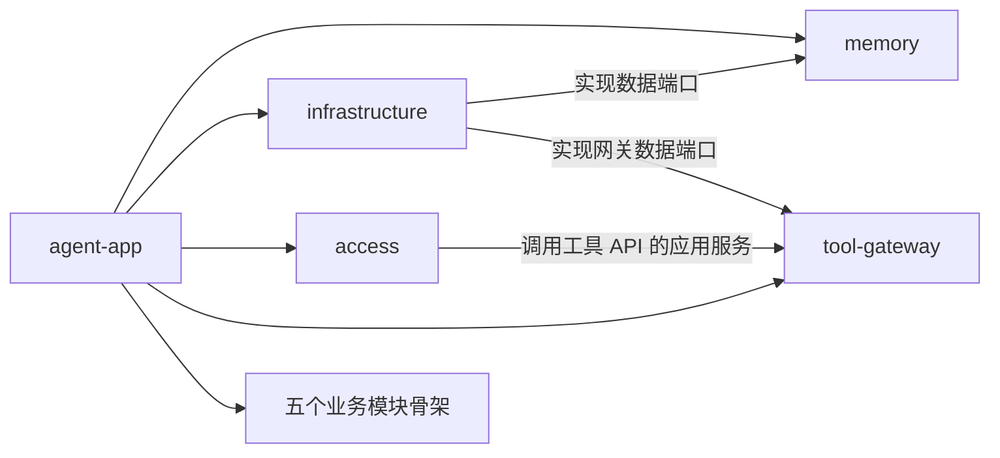

# 模块实现读码指南

从 [启动模块](agent-app.md) 看 Spring 怎样装配 Bean，再读 [记忆模块](memory.md) 的继承关系、[基础设施模块](infrastructure.md) 的存储和 [工具网关](tool-gateway.md) 的 HTTP 调用。其余只有包骨架的模块用设计中的调用链说明后续协作。

| Maven 模块 | 目前可以在源码中看到什么 |
| --- | --- |
| [agent-app](agent-app.md) | Spring Boot 入口、Profile、Actuator 配置 |
| [access](access.md) | ToolGateway HTTP API、JWT 鉴权、SSE 包骨架 |
| [intent-engine](intent-engine.md) | 意图路由、上下文和定义包骨架 |
| [decision](decision.md) | 业务策略和运行路由包骨架 |
| [workflow-skill](workflow-skill.md) | SOP 注册与编译包骨架 |
| [agent-runtime](agent-runtime.md) | Planner、运行、验收、检查点包骨架 |
| [tool-gateway](tool-gateway.md) | 工具版本、授权、HTTP 执行、幂等和审计 |
| [event-bus](event-bus.md) | Outbox 和消费端包骨架 |
| [memory](memory.md) | 六类记忆、抽象父类、Store、Saver、向量索引接口 |
| [infrastructure](infrastructure.md) | MyBatis-Plus、PostgreSQL Saver、Redis Store、Milvus 和 Bean 装配 |

## 先认清三种关系

| 关系 | 代码 | 在项目里的例子 |
| --- | --- | --- |
| 类继承 | `extends` | `WorkingMemory` 继承 `AbstractMemory`，使用父类的公共读写入口 |
| 实现接口 | `implements` | `PostgresCheckpointSaver` 实现 `CheckpointSaver`，定义如何存取快照 |
| 组合与委托 | 构造器注入并持有字段 | `WorkingMemory` 持有 `CheckpointSaver`，读写时委托给它 |

图中箭头表示当前 Maven 依赖。实际一次工作记忆读取由 `WorkingMemory` 发起，通过接口走到基础设施实现。Maven 依赖仍由提供实现的 `infrastructure` 指向定义接口的 `memory`。这就是代码依赖方向和运行时调用方向可以不同的原因。

设计细节见 [设计评审入口](../../design/README.md)，实际表结构见 [数据库目录](../../database/README.md)。
