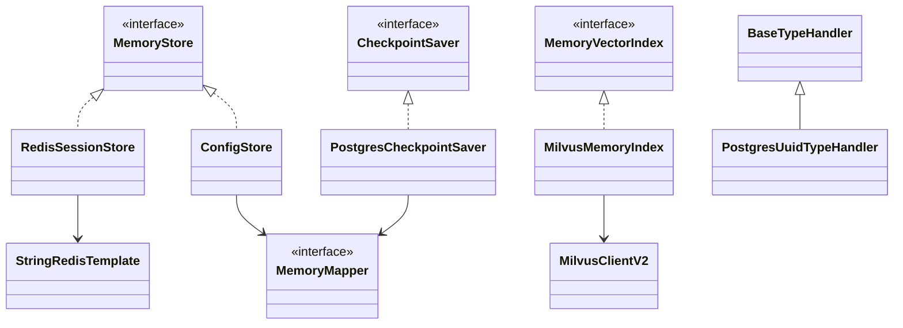

# infrastructure 存储实现与 Bean 装配

入口是 [MemoryStorageConfiguration](../../modules/infrastructure/src/main/java/com/example/enterpriseagent/infrastructure/MemoryStorageConfiguration.java)。配置类受 `@Profile("storage")` 控制，`@MapperScan` 注册 [MemoryMapper](../../modules/infrastructure/src/main/java/com/example/enterpriseagent/infrastructure/persistence/MemoryMapper.java)。Spring 根据 `@Bean` 方法参数提供客户端和事务管理器，配置类再把它们注入六类记忆。

`ConfigStore` 在图中指配置类的私有 `record Store`。它持有读写函数，实现 `MemoryStore`。档案、对话、情节和语义这四种 Bean 都用这个小适配器，分别绑定对应的 Mapper 方法和事务。

## MyBatis-Plus 与 PostgreSQL

- `MemoryMapper` 通过 `@Select`、`@Insert`、`@Update` 声明 SQL。MyBatis-Plus Starter 管理会话工厂并生成 Mapper 代理。字段值用绑定参数传入，主要查询都显式限制租户。
- [PostgresUuidTypeHandler](../../modules/infrastructure/src/main/java/com/example/enterpriseagent/infrastructure/persistence/PostgresUuidTypeHandler.java) 继承 MyBatis 的 `BaseTypeHandler<UUID>`，用 JDBC 的 `setObject` 与 `getObject(..., UUID.class)` 映射 PostgreSQL 原生 UUID。配置中的 `local-cache-scope: statement` 让同一事务里的其它 JDBC 更新也能被后续 Mapper 查询看到。
- 档案写入使用 `ON CONFLICT ... DO UPDATE`，仅当新 revision 更大时更新。对话摘要写入锁定会话行，检查历史代次和覆盖范围。知识发布先锁定文档，检查新版本，再在同一事务退役旧版、发布新版并登记分块。

## Saver 怎样恢复断点

[PostgresCheckpointSaver](../../modules/infrastructure/src/main/java/com/example/enterpriseagent/infrastructure/persistence/PostgresCheckpointSaver.java) 实现 `CheckpointSaver`。追加时用 `FOR UPDATE` 锁住 Run，检查有效计划版本与快照序号，在同一事务写入 `runtime.checkpoint` 和 `runtime.checkpoint_artifact`。必要绑定丢失会触发外键失败并回滚。调用方已有 Run 事务时，追加可参加该事务。

恢复时先查当前有效计划、同一图线程及兼容格式的最新快照，再读同一快照的 `Binding`，组合为 `WorkingMemory.Snapshot`。大对象以产物 ID 关联，具体下载由后续对象存储适配负责。当前 Saver 属于平台持久化端口，LangGraph4j 恢复入口留待执行器接入。

## Redis 与 Milvus

- [RedisSessionStore](../../modules/infrastructure/src/main/java/com/example/enterpriseagent/infrastructure/redis/RedisSessionStore.java) 实现会话版 `MemoryStore`，用 `StringRedisTemplate` 实现键值与 TTL。Redis Streams 的事件消费另由事件模块接入。
- [MilvusMemoryIndex](../../modules/infrastructure/src/main/java/com/example/enterpriseagent/infrastructure/milvus/MilvusMemoryIndex.java) 实现 `MemoryVectorIndex`。首次索引或搜索时创建或加载集合，使用 `FLAT` 索引和 `COSINE` 度量，召回按 `tenant_id` 和记忆类型过滤。它返回来源键和分数，案例和知识内容的访问判断仍由上层 Store 完成。

环境变量、数据库容器启动方式和健康检查见 [数据库启动说明](../../database/README.md#存储启动)。

## ToolGateway 存储装配

[ToolGatewayConfiguration](../../modules/infrastructure/src/main/java/com/example/enterpriseagent/infrastructure/ToolGatewayConfiguration.java) 在 `storage,gateway` 下注册独立的 `GatewayMapper`、`ToolRegistry` 与 `ToolExecutionService`。网关使用独立短事务提交预占与结算，外部 HTTP 调用在两次事务之间运行。[网关调用链](tool-gateway.md)
