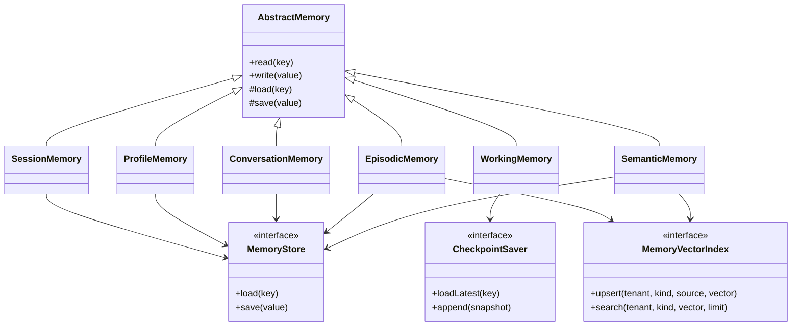

# 记忆系统实现、生命周期与故障恢复

一次对话里可能同时出现三种需求。用户说「是交通」时，助手需要找到原报销任务并合并槽位。用户问「我们刚聊到哪儿」时，助手需要近期问答和摘要。长任务恢复时，Worker 需要知道活动计划、工具执行 ID 和已经完成的产物。这三条路径读取的数据、授权范围和恢复方式各有约定。

## 先认清数据从哪里来

| 对象 | 生命周期 | 用来回答什么 |
| --- | --- | --- |
| `Turn` 与消息 | 一次输入及其回执，随会话保留 | 用户当时说了什么，这一轮系统识别出了什么 |
| `intent.conversation_state` | 每轮提交后更新当前行，存工作状态和修订号 | 当前焦点、待补参任务和已知槽位 |
| `ContextSnapshot` | 解析当前轮时生成的只读视图，承接授权过滤后的证据 | 当前输入能接到哪个 Task，为什么 |
| Chat History / Fresh Context | 每次模型调用前组装，具体内容随任务和阶段变化 | 本次推理需要看到哪些对话或运行证据 |
| `Checkpoint` 与 `Run / Step State` | Run 内逐步持久化，供异步恢复 | 执行到哪一步，哪些证据已提交，哪些外部调用仍在等待 |
| 工具执行与审计 | 随调用和状态变更入库，正文另有保留规则 | 哪个主体用了哪个版本，调用处于什么状态 |

`Store` 是按领域键读写数据的接口。接 PostgreSQL 时可以持久化事实和版本，接 Redis 时可以只保存有 TTL 的会话缓存。`Saver` 面向执行恢复，按 Run、图线程、格式版本和提交序号追加快照。向量索引负责查找相似候选，候选的可见性与有效版本由业务存储复核。Run 事件支持进度回放，事件序号可与检查点对应。

理解这些对象后，可以按「[六类记忆的生命周期](#六类记忆的生命周期) → [三个场景走读](#三个场景走读) → [长任务的工具调用记录](#长任务压缩后工具调用记录在哪里) → [面试问答](#面试问答)」阅读。

## 六类记忆的继承与装配

六类记忆都继承 [AbstractMemory](../../modules/memory/src/main/java/com/example/enterpriseagent/memory/AbstractMemory.java)。父类的泛型 `K` 是查找键，`R` 是读结果，`W` 是写入对象。它们可以各不相同。例如对话记忆读取一个 `Window`，写入的是 `Summary`。



## 父类统一入口，子类重写步骤

`read` 和 `write` 是 `public final` 方法，先用 `Objects.requireNonNull` 检查对象，再调用 `protected abstract load` 或 `save`。子类使用 `@Override` 实现父类约定的两个步骤，这在 Java 中叫**重写**。例如 `ProfileMemory.load` 委托给构造器注入的 `MemoryStore`，`WorkingMemory.load` 委托给 `CheckpointSaver.loadLatest`。

| 子类 | 查找键 `K` | 读结果 `R` / 写入对象 `W` | 当前存取行为 |
| --- | --- | --- | --- |
| [SessionMemory](../../modules/memory/src/main/java/com/example/enterpriseagent/memory/session/SessionMemory.java) | 租户、用户、会话 ID | `Optional<String>` / `Entry` | Redis 存 JSON 和 TTL，过期后读取为空 |
| [ProfileMemory](../../modules/memory/src/main/java/com/example/enterpriseagent/memory/profile/ProfileMemory.java) | 租户、用户、档案字段键 | `Optional<Item>` / `Item` | PostgreSQL 精确查询，跳过过期记录。写入时校验修订号单调增加 |
| [ConversationMemory](../../modules/memory/src/main/java/com/example/enterpriseagent/memory/conversation/ConversationMemory.java) | 租户、会话、用户、窗口条数 | `Window` / `Summary` | 同一读取事务组合有效摘要与摘要水位之后的消息引用。写入只追加新的摘要 |
| [WorkingMemory](../../modules/memory/src/main/java/com/example/enterpriseagent/memory/working/WorkingMemory.java) | 租户、Run、图线程、格式版本 | `Optional<Snapshot>` / `Snapshot` | Saver 追加工作记忆，恢复当前计划的最新兼容快照和产物绑定 |
| [EpisodicMemory](../../modules/memory/src/main/java/com/example/enterpriseagent/memory/episode/EpisodicMemory.java) | 租户、案例、用户和可信范围 | `Optional<Episode>` / `Episode` | 从已完成的 Run 形成案例。索引召回后核对案例状态、用户或租户可见性及有效期 |
| [SemanticMemory](../../modules/memory/src/main/java/com/example/enterpriseagent/memory/semantic/SemanticMemory.java) | 租户、文档、可信访问策略引用 | `Optional<Version>` / `Publication` | 发布文档版本和分块，索引键带文档版本，读取时复核访问策略和当前生效版本 |

## 三段实际调用链

**会话读写。** `SessionMemory.write(entry) → AbstractMemory.write → SessionMemory.save → RedisSessionStore.save`。Redis 键的三段身份分别做 Base64 URL 编码，TTL 由 `Entry` 提供。读取用相同的键，过期或查无记录时返回空。

**聊天窗口。** 例如有效摘要的 `coveredThroughSeq=32`，Store 从同一会话读 `seq > 32` 且正文仍可见的最近消息，按时间顺序返回。摘要的 `historyRevision` 必须与会话当前值匹配。窗口条数由 `ConversationMemory.Key` 检查在 1 到 200 之间。正文和摘要返回受控引用。聊天实际调用会按当轮位置组装历史，过程见下文。

**检索长期记忆。** `EpisodicMemory` 和 `SemanticMemory` 使用 PostgreSQL Store 与 Milvus VectorIndex。启用 `memory-loop` 后，发布和成功结算事务先保存源记录与索引作业，Worker 再生成 Embedding 并写入 Milvus。召回从 Milvus 取得候选，逐个回查 PostgreSQL。知识旧版本、过期案例及其他用户的案例会在回查时过滤。

## 六类记忆的生命周期

### 1. Session Memory · 会话缓存

- **解决的问题。** 存放允许丢失、可以重新获取的短期会话视图，例如前端临时选择或某个组件的临时 JSON。缓存键由租户、用户和 Session ID 三段组成。
- **何时写、读、失效。** 调用方在需要缓存这份数据时调用 `SessionMemory.write(Entry)`，同时提供正数 TTL。同键再次写入时覆盖原值并设置本次 TTL。调用方用原键读取，Redis 到期或键不存在时返回空。
- **放在哪里，如何恢复。** 这是 Redis KV 路径，无对应 PostgreSQL 表。当前意图识别主链读取 PostgreSQL 的 `intent.conversation_state`。Redis 里的临时视图失效后，可从业务源重建的视图重新计算；待补参任务则沿 PostgreSQL 会话状态继续。[RedisSessionStore](../../modules/infrastructure/src/main/java/com/example/enterpriseagent/infrastructure/redis/RedisSessionStore.java) · [会话提交与读取](../../modules/infrastructure/src/main/java/com/example/enterpriseagent/infrastructure/intent/PostgresIntentStore.java)

### 2. Profile Memory · 跨会话用户偏好

- **解决的问题。** 新开会话时仍可读取该用户已确认的语言和报告风格。当前接口支持 `locale`、`reportStyle`，由服务端校验允许的取值。
- **何时写、读、失效。** 用户确认偏好后调用 `PUT /v1/memory/profile/{key}`，携带值和递增修订号。低版本写入返回冲突。档案存储支持可选到期时间，本接口写入的确认偏好没有设置到期时间。特定单候选业务或对话在识别后按需加载；聊天 Worker 在模型调用前读取允许的偏好值。识别调试视图展示字段键。
- **放在哪里，如何恢复。** `memory.profile_item` 按 `tenant_id + user_id + item_key` 精确读取，保存 JSON 值、来源、修订号及到期字段。切换会话或刷新页面后仍从 PostgreSQL 读取。字段缺失时由当前应用或对话使用默认行为。[MemoryLoop](../../modules/infrastructure/src/main/java/com/example/enterpriseagent/infrastructure/memory/MemoryLoop.java) · [MemoryMapper](../../modules/infrastructure/src/main/java/com/example/enterpriseagent/infrastructure/persistence/MemoryMapper.java)

### 3. Conversation Memory · 正文、窗口与摘要

- **解决的问题。** 给聊天模型保留必要的上下文，同时限制每次传输的历史长度。另有持久消息支持按权限查看会话和历史回顾。
- **何时写。** Turn 提交时写 `intent.message` 的消息顺序和正文引用，正文在 `intent.conversation_body`。符合条件的单意图 CHAT 轮次尝试推进摘要水位，聊天 Worker 读取历史时也可推进。摘要元数据追加到 `memory.conversation_summary`，摘要正文同样保存在 `intent.conversation_body`。
- **何时读、如何恢复。** 以当前轮消息序号和 `history_revision` 作为边界，只读当前轮之前的已完成且可见聊天。恢复时用会话身份重新读取兼容摘要和窗口。长对话逐渐淡出模型可见范围，持久消息另按各自的可见性、清空和保留策略管理。显式清空会产生新历史代次，旧摘要不会进入新一代聊天上下文。[摘要生成与读取](../../modules/infrastructure/src/main/java/com/example/enterpriseagent/infrastructure/intent/PostgresConversationSummary.java)

### 4. Working Memory · Run 检查点与证据

- **解决的问题。** 长任务跨进程、跨重启和跨审批恢复。Run 级工作记忆虽然只服务于当前任务，检查点和证据需要持久化。
- **何时写。** 受理、计划变化、节点结算等运行边界调用 `CheckpointSaver.append()`，记录检查点序号、计划版本、图线程、格式版本和已提交产物绑定。节点结算时同步保存产物元数据与正文、运行状态及事件。等待审批的节点保留网关执行 ID，Worker 释放执行槽位。
- **何时读、如何恢复。** Worker 重新领取节点后，从活动计划的 `runtime.checkpoint` 和 `runtime.checkpoint_artifact` 取最新兼容快照。先恢复 `节点键 → artifactId`，再按需查 `runtime.context_artifact` 和对应正文。调度和等待状态还要读 `runtime.run`、`runtime.step` 与网关的执行状态。[PostgresCheckpointSaver](../../modules/infrastructure/src/main/java/com/example/enterpriseagent/infrastructure/persistence/PostgresCheckpointSaver.java) · [RunManager](../../modules/agent-runtime/src/main/java/com/example/enterpriseagent/runtime/RunManager.java)

### 5. Episodic Memory · 成功案例

- **解决的问题。** 下次识别到同一类业务场景，可以找到该用户此前完成的案例线索。自动案例目前保存了场景标识、执行模式、完成状态及来源 Run 关联。
- **何时写、读、失效。** 启用 `memory-loop` 后，符合条件的主 Run 成功结算时，同一事务按源 Run 去重写 `memory.task_episode` 和 `memory.index_job`。自动案例为用户私有，90 天后过滤。符合条件的已就绪单意图业务，在具备 `runs.read` 时按场景召回，调试页显示案例 ID。
- **如何恢复。** Worker 从 PostgreSQL 的索引作业恢复 Embedding 写入。Milvus 返回候选引用后，由 Store 复核租户、用户、状态、有效期与场景。当前自动案例可用于找回案例线索，完整工具轨迹仍应按源 Run 查询。案例沉淀也无需把每次对话原文或工具响应写进向量库。[案例写入与召回](../../modules/infrastructure/src/main/java/com/example/enterpriseagent/infrastructure/memory/MemoryLoop.java)

### 6. Semantic Memory · 版本化业务知识

- **解决的问题。** 用制度、手册和业务规则回答「报销有什么规定」等问题，并带着可核对的知识来源。
- **何时写、读、失效。** 通过知识发布 API 提交版本和分块；文档、版本、分块、正文和索引作业一同写入 PostgreSQL。Worker 随后向量化并写 Milvus。知识问答时按租户和查询文本召回候选，应用分数阈值，再核对当前有效版本和读取权限。知识换版后，旧向量即使短暂留在索引里，也会在 PostgreSQL 回查时被筛掉。
- **放在哪里，如何恢复。** 权威记录是 `memory.knowledge_document`、`memory.knowledge_version`、`memory.knowledge_chunk`、`memory.knowledge_chunk_body`；索引作业是 `memory.index_job`。恢复索引可以从这些源文档版本重新构建。当前本地知识路径返回知识分块摘录及来源引用，历史关联在读时也会核对版本。[知识发布与摘录](../../modules/infrastructure/src/main/java/com/example/enterpriseagent/infrastructure/memory/MemoryLoop.java)

## 开启记忆闭环

在 API 和 Worker 加上 `memory-loop`，已有库执行 [010 迁移](../../database/migrations/010-memory-loop.sql)。Worker 还需启用 `worker`。通过 `ENTERPRISE_GATEWAY_EMBEDDING_URI`、`EMBEDDING_API_KEY`、`EMBEDDING_MODEL` 配置 Embedding，`ENTERPRISE_EMBEDDING_DIMENSION` 必须与模型输出及 Milvus 集合一致。`enterprise.memory.minimum-score` 控制知识召回阈值。

| 数据 | 入库和更新 | 出库 |
| --- | --- | --- |
| 档案 | 用户用 `memory.profile.write` 凭证调用 `PUT /v1/memory/profile/{key}`，提交 `value` 与递增的 `revision`。支持 `locale` 和 `reportStyle` | Context Assembler 按租户和用户精确读取，调试产物显示命中的字段名。闲聊模型仅接收允许的偏好值 |
| 任务案例 | Run 成功时，与结算事务一起写入 `memory.task_episode` 和 `memory.index_job`。自动案例是用户私有、有效期 90 天，摘要保存业务场景、执行模式和结果状态 | 单个已就绪的工作流或开放任务按场景召回案例。ContextSnapshot 显示有权限的历史案例 ID |
| 知识 | 知识管理员通过 `PUT /v1/memory/knowledge/{document}/versions/{version}` 提交 `sourceKey` 和 `chunks`。更新使用更高版本，正文存入 `memory.knowledge_chunk_body` | `memory.knowledge.read` 用户提问时走本地向量检索，返回摘录及版本引用。轮次只存引用，刷新时重新检查当前有效版本 |
| 索引作业 | Worker 领取 `memory.index_job` 租约。可按同一引用幂等 Upsert，暂时失败按次数延后，第六次失败写入 `failed_at` | Milvus 只索引向量与引用。案例索引的文本为业务场景标识，知识索引的文本为发布的知识分块 |

例如第一次分析财务报表成功后，下一次同类请求的 `ContextSnapshot.memory.episodeIds` 可以看到先前案例。知识问答以摘要式摘录返回来源。知识换版后，历史轮次引用如果全部失效会显示 `KNOWLEDGE_VERSION_UNAVAILABLE`。

继续看 [基础设施模块](infrastructure.md)里的 SQL、事务和 Bean 如何把这些接口接到真实存储。

## 对话摘要怎么生成和使用

`storage,intent,gateway` 打开 CHAT 历史压缩。配置 `enterprise.intent.chat.enabled=true` 和聊天模型后，聊天 Worker 会把摘要和最近窗口一同发送给该模型。当前使用抽取式摘要，保留最近八个旧闲聊轮次的问答片段，每一侧最多 160 个 Unicode 字符。生成过程在应用内完成，无需额外的模型请求。

1. **轮次落库。** `PostgresIntentStore.commit` 先写消息正文与递增序号。提交单意图 CHAT 时，调用 `PostgresConversationSummary.afterTurn`。最后 16 条消息属于最近窗口，对更早、已完成的单意图 CHAT 轮次生成摘要。已完成的助手回答来自 `intent.route_job.output`。如果窗口外还有正在排队的旧闲聊，摘要水位先停在那轮之前，让回答完成后还有机会进入摘要。
2. **摘要落库。** 同一事务在 `intent.conversation_body` 写结构化片段，再通过 `ConversationMemory.write` 追加 `memory.conversation_summary`，保存历史代次、覆盖水位和摘要正文引用。`conversation-extractive-v1` 记录摘要算法版本，`source_digest` 对上一摘要的摘要值与当前采用的来源片段计算指纹。会话锁和单调水位防止并发或延迟请求覆盖更新的摘要。
3. **模型读取。** `ConversationRouteJobs` 根据租户、用户、Agent 和轮次校验会话身份，读取当前轮之前的兼容摘要和最近窗口。模型收到 `currentMessage`、`summary`、`recent` 三个字段。最近窗口保留原句格式，每条最多 512 个 Unicode 字符。只有单意图 CHAT 轮次能进入此模型上下文，业务工具结果和其他业务对话由各自的运行链路处理。
4. **清空与续聊。** 清空上下文会增加 `history_revision`，将旧消息标为不可见并移除正文引用，清空同身份的会话路由作业载荷与结果，同时关闭相关待澄清项和待确认项。下一轮仅能读取新代次的历史。旧摘要元数据与底层正文的实际保留，另由存储生命周期管理。

例如先聊「你好，海棠花」，再完成九轮闲聊。第十轮调用模型时，第一轮问答已经可以出现在 `summary`，最近的聊天则在 `recent`。如果中途提交过「查询订单 SO713」，这条业务请求不会进入闲聊模型。清空上下文后再发一轮闲聊，两个历史列表均为空。

可以在独立联调库运行 `node scripts/runtime-smoke.mjs <JAR> --conversation-summary-only`，用本地模型夹具查看窗口、摘要、业务隔离和清空后的结果。旧库沿用现有消息、摘要与 [009 会话路由表](../../database/migrations/009-conversation-route-jobs.sql)。[摘要生成与读取](../../modules/infrastructure/src/main/java/com/example/enterpriseagent/infrastructure/intent/PostgresConversationSummary.java) · [聊天 Worker](../../modules/infrastructure/src/main/java/com/example/enterpriseagent/infrastructure/intent/ConversationRouteJobs.java)

## 三个场景走读

### 场景一 · 报销补参跨了三轮

| 时间 | 存取发生在哪 | 用户能观察到什么 |
| --- | --- | --- |
| 第一轮「提交 OA 报销」 | 读取会话工作状态，识别 `EXPENSE.OA_SUBMIT`，按定义检查必填。写本轮消息、候选、Task、待澄清项和最新 `conversation_state`。 | 缺标题、类别、金额、日期和说明。Task 已建立，执行列表为空。 |
| 第二轮「是交通」 | Context Assembler 冻结本轮工作快照。Context Resolver 结合回复引用或唯一兼容的待补参任务，选择原 Task。槽位合并后更新输入版本和待澄清项。 | Task ID 沿用，已填的类别出现在产物里。 |
| 第三轮「标题：客户拜访，金额：12.34 元，费用日期：今天，说明：打车」 | 继续合并原 Task 的输入，校验金额和完整性，保存 `ValidatedIntentIR`。路由以该输入版本受理，网关写工具执行和审批。 | 进入 `WAITING_APPROVAL`，会话内能查到执行 ID。金额转为 1234 分。 |
| 审批者批准 | 网关按审批对应的执行 ID 和参数摘要恢复作业，向 OA 传稳定的请求标识，回填脱敏回执。 | 同一执行从挂起走向终态，OA 单号来自下游回执。 |

这条链使用的是**结构化补参**。关键证据是 Task、槽位来源、澄清状态及输入版本。聊天摘要可以丢掉旧话题里的细节，报销类别仍由原任务的输入版本管理。两个报销都可能接收「交通」时，Context Resolver 会优先采用明确回复或可消歧的证据，仍无法唯一定位时要求选择。会话任务用于关联的有效条件包含最近更新 30 分钟内及距离当前会话修订不超过 20 次，这属于续接匹配条件，历史数据库记录有自己的保留策略。[Context Resolver](../../modules/intent-engine/src/main/java/com/example/enterpriseagent/intent/context/ContextResolver.java) · [OA 补参与审批](oa-business-system-integration.md#6-接入会澄清的创建操作)

### 场景二 · 闲聊回忆、切换会话与知识更新

1. 第一次聊到「我想把周报写得简洁些」，本轮原文按会话保存。若用户另外通过偏好接口确认报告风格，才形成跨会话档案。由模型临时猜出的习惯无需写成用户事实。
2. 同会话再聊多轮。较早且已完成的聊天落入摘要，近期聊天原文进入窗口；当前消息单独发送。第十轮问「刚聊的建议是什么」时，可以用近期正文或摘要继续回答。明确查询指定历史轮次的请求还可由会话历史路径按授权读取持久消息。
3. 新开会话，聊天历史按新会话 ID 读取，已确认的档案按用户键读取。旧会话仍可在对应会话内查看。两条历史生命周期由不同键限定。
4. 用户问制度时，走知识召回。如果管理员把报销制度从第 1 版更新到第 2 版，数据库中的有效版本决定可以引用哪一版。索引更新期间，可能暂时没有可用证据；这时回执应反映知识未命中或版本不可用。

这个场景回答「为什么系统记得语气偏好，却记不住某一轮的逐字内容」。偏好由用户确认后精确查，摘要对模型可见的历史片段有容量和覆盖边界。需要逐字回看时，沿受授权的消息历史查正文。[会话和历史接口](intent-engine.md) · [历史、状态与快照](persistence-lifecycle.md)

### 场景三 · 销售分析中断、重规划与复用

以 `source → 地区和产品分析 → 报告 → Hard-Gate` 为例：

1. **受理。** 固定已验证的 Task Input 与执行身份，创建 Run、计划和初始检查点。用业务幂等键重试提交可找回原 Run。
2. **取数。** 数据源节点通过网关执行。节点保存 `tool_execution_id`；拿到并校验结果后，将结构化结果写成运行产物。同一结算事务更新节点状态、调用关联和检查点。
3. **暂停或重启。** 若重启时已有执行 ID，Worker 先回查网关状态；若节点已经结算，则恢复观察产物引用。租约到期后可由新 Worker 接管，结算要核对租约，避免旧 Worker 的迟到结果覆盖新状态。
4. **检验并重规划。** 假设报告包含地区结果，缺产品分析。`runtime.gate_check` 记录未满足的检查项，Ralph 以证据引用、缺口和剩余预算构造 Fresh Context。新版计划可以复用已完成、经校验的地区和源数据产物，补算产品维度并重生成报告。
5. **输出与沉淀。** 结果接口按 Run 查报告。启用记忆闭环且符合条件时，成功主 Run 另外沉淀用户私有的场景案例。SSE 客户端可带 `Last-Event-ID` 从数据库事件序号继续接收进度。

这个例子有两种恢复。**执行恢复**靠存量 Run、Step、检查点和执行 ID。**推理恢复**靠重新组装 Fresh Context，让模型看见本轮决策所需的证据。外部结果未知时按对账规则处理，单凭摘要或模型推断不能确认已写入，也不应重新调用可能已生效的写工具。[Run Manager 与 Ralph](agent-runtime.md#一次运行怎么推进) · [事件与 SSE](event-bus.md)

## 长任务压缩后工具调用记录在哪里

**上下文压缩不会删除工具执行记录。** 判断某次调用是否存在、是否成功、是否能取回原正文，需要追踪三条不同的数据链。

| 要查的问题 | 查什么 | 能看到什么 |
| --- | --- | --- |
| 本 Run 哪个节点触发了工具 | `runtime.step.tool_execution_id`；也可按 `gateway.tool_execution.run_id + step_id` 反查 | 节点、计划版本、操作键、网关执行 ID |
| 调用由谁发起，实际状态是什么 | `gateway.tool_execution`、`gateway.tool_version`、`gateway.audit_entry` | 操作者、工具版本、参数指纹、执行状态、追踪 ID、审计动作 |
| 后续计算用的是哪份结果 | `runtime.checkpoint_artifact → runtime.context_artifact → runtime.artifact_body` 或 MinIO | 稳定产物 ID、正文引用、摘要、大小和经过治理的证据 |
| 完整原始请求与响应是否还能读 | 网关作业保留策略和运行产物契约 | 仅能按权限读取实际保存的字段。网关可返回脱敏结果；参数指纹不支持还原原文 |

`gateway.tool_job` 保存可恢复作业的加密数据。当前终态作业满足 `deadline_at < now() - interval '1 day'` 时进入清理范围，清理的是作业载荷。该时间从作业截止时间计算。工具执行和独立审计行有自己的存储生命周期。类似地，清理 Redis Stream 的事件与 SSE 使用的 `runtime.run_event` 分属不同保留路径。面试里说「永久保存所有工具输入输出」会把可追溯性和数据保留混在一起。[网关作业清理](../../modules/infrastructure/src/main/java/com/example/enterpriseagent/infrastructure/gateway/GatewayMapper.java#L483) · [EventBus 保留策略](event-bus.md#保留与重投)

### 卸载后怎么取回证据

1. 节点成功结算，先在 PostgreSQL 写正文和元数据，检查点引用稳定的 `artifactId`。
2. 配置了对象卸载的 Worker 领取符合条件的大正文，按稳定对象键上传。上传失败时内联正文仍可读取。
3. 上传成功且租约仍有效，事务提交 `content_ref` 从 `pg:` 到 `obj:` 的切换，保存摘要和长度并移除内联正文。检查点引用继续有效。
4. 恢复时根据租户、Run 和产物 ID 读取元数据，按引用取正文。对象存储读取要核对摘要与长度。远端暂不可读或不一致时，按预算重试或返回产物不可用，等待证据恢复。

压缩解决模型输入太大；卸载解决大正文给主库和状态快照带来的负担；检查点解决执行续跑；审计解决事后追溯。四项设计可以在一次 Run 中同时发生。[产物搬运、校验与恢复](runtime-artifact-storage.md)

### 从 Run ID 排查一条调用

会话发起的任务可从右栏的 `Run`、`PlanVersion`、`ToolCall`、`ToolResult` 和 `StateUpdate` 开始查。单独用长任务 API 发起的 Run 可先用 `GET /v1/runs/{runId}` 和 SSE 查看状态，成功后用结果接口查看报告。具有授权的运维人员也可以用下面的只读 SQL 关联记录。将变量 `tenant`、`run_id` 设置为目标租户和运行 ID。

```sql
SELECT s.plan_version,
       s.node_key,
       s.status AS step_status,
       e.id AS tool_execution_id,
       t.name AS tool_name,
       v.version_name AS tool_version,
       e.status AS tool_status,
       e.trace_id,
       s.observation_ref
FROM runtime.step s
LEFT JOIN gateway.tool_execution e
  ON e.tenant_id = s.tenant_id AND e.id = s.tool_execution_id
LEFT JOIN gateway.tool t
  ON t.tenant_id = e.tenant_id AND t.id = e.tool_id
LEFT JOIN gateway.tool_version v
  ON v.tenant_id = e.tenant_id AND v.id = e.version_id
WHERE s.tenant_id = :'tenant' AND s.run_id = :'run_id'::uuid
ORDER BY s.plan_version, s.node_key;

SELECT c.seq, c.plan_version, b.binding_key, a.id AS artifact_id,
       a.kind, a.size_bytes, split_part(a.content_ref, ':', 1) AS storage_kind
FROM runtime.checkpoint c
JOIN runtime.checkpoint_artifact b
  ON (b.tenant_id, b.run_id, b.checkpoint_seq) = (c.tenant_id, c.run_id, c.seq)
JOIN runtime.context_artifact a
  ON (a.tenant_id, a.run_id, a.id) = (b.tenant_id, b.run_id, b.artifact_id)
WHERE c.tenant_id = :'tenant' AND c.run_id = :'run_id'::uuid
ORDER BY c.seq DESC, b.binding_key;
```

查询只返回排查用元数据。查明执行 ID 后，可沿网关查询接口或审计表核对详情。读取产物正文时沿业务接口走权限检查。[库表链路和字段](persistence-lifecycle.md#从数据库追踪一轮)

## 设计取舍与故障演练

| 如果发生 | 当前行为 | 验收时观察 |
| --- | --- | --- |
| Redis 会话键过期 | 缓存读取为空；多轮补参的持久状态由 PostgreSQL 加载 | 持久消息和 Task 仍可按授权访问，缓存值可重建 |
| Redis Streams 暂时中断 | 业务提交仍保有 PostgreSQL 状态和 Outbox；适用链路按数据库轮询恢复 | 恢复后不重复推进同一事件，SSE 还能沿 Run Event 序号补发 |
| 模型上下文过短或摘要有遗漏 | 当前聊天可能无法逐字回忆；精确业务参数靠持久槽位，运行证据按引用定位 | 用历史回顾和已知 Task 对照，检查模型输入只包含需要的字段 |
| Worker 在外部调用过程中停机 | 根据节点已有执行 ID、租约和稳定操作键恢复。外部副作用不明确时保留待对账状态 | 查看同一执行 ID 的状态与审计；验证不存在盲目重复写入 |
| Milvus 索引延迟或召回过时 | 档案精确查询和检查点恢复独立于向量索引，知识和案例候选会回查当前版本及权限 | 发布或撤权后旧知识不会因向量仍存在而重新可见 |
| MinIO 暂不可读 | 已卸载产物沿校验失败和重试路径处理，API 可返回产物不可用 | 节点记录错误和恢复重试；对象恢复后可重新读证据 |
| 两次补参或两个 Worker 同时更新 | 会话用修订号和事务处理提交；检查点按序追加；运行结算核对租约 | 后到请求不应悄悄覆盖新修订，旧 Worker 不能提交过期结算 |

**可继续演进的方向。** 对生产租户，可以按数据类别分别配置保留期、脱敏和审计检索；知识检索可加词法召回、重排与离线评测；对话摘要可增加可验证的事实提取与回链。若要支持跨任务复用完整案例，应先定义允许携带的证据字段、来源可见性、归属与撤销规则，再扩展当前的场景案例索引。备份和恢复要同时考虑数据库记录、外部正文和仍需解密的网关作业。

## 面试问答

| 常见问题 | 可以怎样回答 |
| --- | --- |
| 你们的短期记忆都放 Redis 吗？ | 短期描述使用范围。Session 临时 JSON 放 Redis 并带 TTL，当前会话业务状态和 Run 工作记忆虽然作用范围短，也要持久化到 PostgreSQL，才能在重启后继续。 |
| `conversation_state` 是最新的一轮对话吗？ | 它是一份累积工作视图。最近的 Turn 记录本轮输入和回执，`conversation_state` 还包含更早轮次保留的焦点、任务和槽位，ContextSnapshot 以授权后的状态为基底补充本轮证据。 |
| Store 和 Saver 为什么要分开？ | Store 按业务主键维护事实及版本。Saver 按执行线程和提交序号追加检查点，绑定计划版本和产物。恢复、并发和保留策略因此能围绕各自的读写契约设计。 |
| 摘要怎么避免漏掉还在生成的助手回复？ | 用消息序号当水位，并在仍排队且未过期的旧 CHAT 轮次前停下。读取采用当前历史代次和本轮之前的水位，结合会话锁和单调水位更新。 |
| 多轮补参与普通聊天记忆怎样分流？ | 补参查待澄清 Task 和输入版本，通过 Context Resolver 找归属，再由 Slot Merger 合并和校验。聊天模型读取筛选后的消息窗口与摘要，业务工具结果走运行产物路径。 |
| 模型超出上下文以后还能找原工具吗？ | 可以按持久化的 Step 与执行 ID 回查。Fresh Context 引用已提交证据，检查点和网关执行记录独立于模型输入。原始载荷是否仍可读由脱敏和保留规则决定。 |
| 重放事件会把外部订单下两次吗？ | 事件按 ID 去重。业务派发使用稳定操作键，已受理时按执行 ID 查询。最终还要看下游是否支持幂等和状态查询；遇到未知副作用要对账，系统只在这些契约允许的范围内重试。 |
| 为什么向量检索后还回查数据库？ | 向量索引能提供相似候选，但更新、删除和授权变动都可能有传播延迟。PostgreSQL 按租户、当前版本、可见性和有效期复核后才返回可见正文或案例。 |
| 清空会话会清掉用户档案和审批账本吗？ | 清空会话主要切换会话的历史代次并处理旧历史的可见性及待处理聊天。档案键属于用户维度，工具审计和运行记录各自管理，涉及真正删除时应按数据类别定义清理流程。 |
| 线上如何定位“助手忘了”的问题？ | 先定位会话、轮次和数据类型。补参查 `ContextRelation`、槽位及输入版本；聊天查历史代次、窗口和水位；知识查权限、索引作业和版本；长任务查 Run、活动计划、检查点和产物读取状态。 |

面试可以用一句话起头：「我先把记忆拆成会话理解、模型输入、运行恢复和长期检索，再按生命周期选存储。」接着用销售分析的一次断点恢复回答两个核心问题：哪些数据在什么事务里提交，重启后系统凭什么知道下一步和已经完成的工作。

[记忆设计与验收](../../design/memory.md) · [数据库字典](../../database/dictionary.md) · [完整持久化生命周期](persistence-lifecycle.md)
