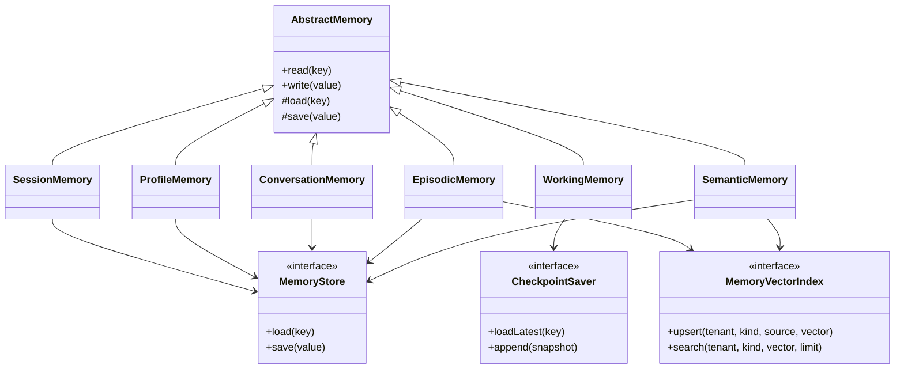

# memory 六类记忆的继承与读写

六类记忆都继承 [AbstractMemory](../../modules/memory/src/main/java/com/example/enterpriseagent/memory/AbstractMemory.java)。父类的泛型 `K` 是查找键，`R` 是读结果，`W` 是写入对象。它们可以各不相同。例如对话记忆读取一个 `Window`，写入的是 `Summary`。

## 父类统一入口，子类重写步骤

`read` 和 `write` 是 `public final` 方法，先用 `Objects.requireNonNull` 检查对象，再调用 `protected abstract load` 或 `save`。子类使用 `@Override` 实现父类约定的两个步骤，这在 Java 中叫**重写**。例如 `ProfileMemory.load` 委托给构造器注入的 `MemoryStore`，`WorkingMemory.load` 委托给 `CheckpointSaver.loadLatest`。

| 子类 | 查找键 `K` | 读结果 `R` / 写入对象 `W` | 当前存取行为 |
| --- | --- | --- | --- |
| [SessionMemory](../../modules/memory/src/main/java/com/example/enterpriseagent/memory/session/SessionMemory.java) | 租户、用户、会话 ID | `Optional<String>` / `Entry` | Redis 存 JSON 和 TTL，过期后读取为空 |
| [ProfileMemory](../../modules/memory/src/main/java/com/example/enterpriseagent/memory/profile/ProfileMemory.java) | 租户、用户、档案字段键 | `Optional<Item>` / `Item` | PostgreSQL 精确查询，跳过过期记录。写入时校验修订号单调增加 |
| [ConversationMemory](../../modules/memory/src/main/java/com/example/enterpriseagent/memory/conversation/ConversationMemory.java) | 租户、会话、用户、窗口条数 | `Window` / `Summary` | 同一读取事务组合有效摘要与摘要水位之后的消息引用。写入只追加新的摘要 |
| [WorkingMemory](../../modules/memory/src/main/java/com/example/enterpriseagent/memory/working/WorkingMemory.java) | 租户、Run、图线程、格式版本 | `Optional<Snapshot>` / `Snapshot` | Saver 追加工作记忆，恢复当前计划的最新兼容快照和产物绑定 |
| [EpisodicMemory](../../modules/memory/src/main/java/com/example/enterpriseagent/memory/episode/EpisodicMemory.java) | 租户、案例、用户和可信范围 | `Optional<Episode>` / `Episode` | 从已完成的 Run 形成案例。索引召回后核对案例状态、用户或租户可见性及有效期 |
| [SemanticMemory](../../modules/memory/src/main/java/com/example/enterpriseagent/memory/semantic/SemanticMemory.java) | 租户、文档、可信访问策略引用 | `Optional<Version>` / `Publication` | 发布文档版本和分块，索引键带文档版本，读取时复核访问策略和当前生效版本 |

## 三段实际调用链

**会话读写。** `SessionMemory.write(entry) → AbstractMemory.write → SessionMemory.save → RedisSessionStore.save`。Redis 键的三段身份分别做 Base64 URL 编码，TTL 由 `Entry` 提供。读取用相同的键，过期或查无记录时返回空。

**聊天窗口。** 例如有效摘要的 `coveredThroughSeq=32`，Store 从同一会话读 `seq > 32` 且正文仍可见的最近消息，按时间顺序返回。摘要的 `historyRevision` 必须与会话当前值匹配。窗口条数由 `ConversationMemory.Key` 检查在 1 到 200 之间。正文和摘要返回受控引用，摘要生成器和正文对象存储留待业务接入。

**检索长期记忆。** `EpisodicMemory` 和 `SemanticMemory` 同时持有 Store 与 VectorIndex。`index` 先读取当前可见的权威记录，再用调用方提供的向量写入索引。`search` 从 Milvus 得到候选引用，再逐个回查 PostgreSQL。知识旧版本命中时会被过滤。写 PostgreSQL 和更新索引是两次调用，后台索引同步和 Embedding 生成留待接入。

继续看 [基础设施模块](infrastructure.md)里的 SQL、事务和 Bean 如何把这些接口接到真实存储。
