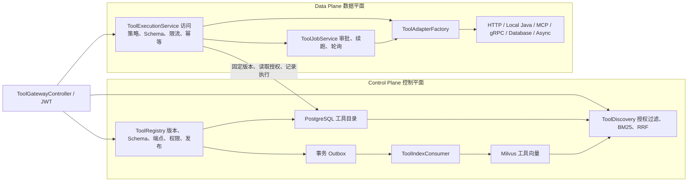
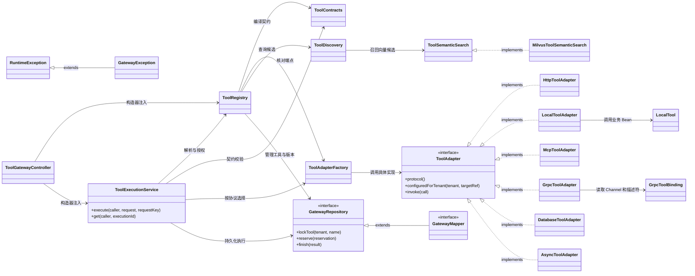
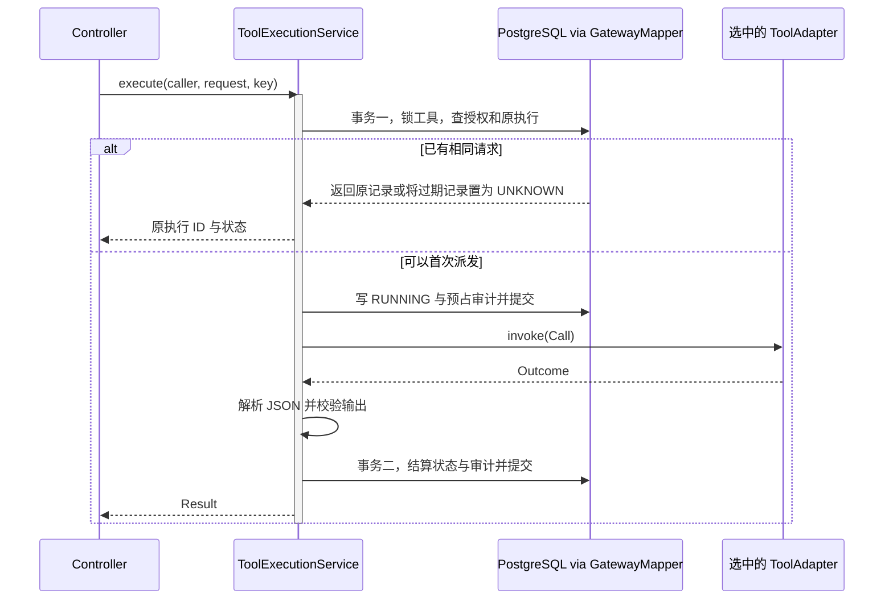

# tool-gateway 工具治理

控制平面管理工具目录、契约、版本、权限和发布。数据平面接收调用、复核权限、校验参数、记录幂等执行并选择协议适配器。Agent 从发现接口拿到带分数的候选，再按候选版本查 Schema、发起调用。

如果你从 Function Calling 入门，可以先读[从注册到执行 · ToolGateway 学习问答](tool-gateway-learning-notes.md)。其中保留了关于 A/B 两种接法、当前系统的配置路由、MCP 和网关治理的讨论，并用真实 OA 绑定逐步对照代码。

继续看[Tool Middleware、审批与异步恢复](tool-gateway-middleware.md)，可以按受理、派发和结算理解治理顺序，再追踪审批及 Checkpoint 如何配合。



## 类继承与接口实现

这里有三种关系。类继承看 `extends`，接口实现看 `implements`，对象协作看构造器和持有的字段。网关的业务服务主要用构造器组合，协议和数据库访问通过接口接入。



| 源码声明 | 读法 |
| --- | --- |
| 六个适配器 `implements ToolAdapter` | 各自覆盖 `protocol`、`configured` 和 `invoke`，通过 `configuredForTenant` 可追加租户约束。Factory 以协议枚举绑定接口实现。[ToolAdapter](../../modules/tool-gateway/src/main/java/com/example/enterpriseagent/toolgateway/adapter/ToolAdapter.java) · [ToolAdapterFactory](../../modules/tool-gateway/src/main/java/com/example/enterpriseagent/toolgateway/adapter/ToolAdapterFactory.java) |
| 业务 Bean `implements LocalTool` | 自有 Java 工具实现 `name()` 和 `run(arguments, context)`。Local Adapter 按名找到 Bean 并传入可信调用上下文。[LocalTool](../../modules/tool-gateway/src/main/java/com/example/enterpriseagent/toolgateway/adapter/LocalTool.java) |
| `MilvusToolSemanticSearch implements ToolSemanticSearch` | 工具模块只依赖索引和检索接口。基础设施生成 Embedding，再委托 Milvus 存取向量。[ToolSemanticSearch](../../modules/tool-gateway/src/main/java/com/example/enterpriseagent/toolgateway/discovery/ToolSemanticSearch.java) |
| `GatewayMapper extends GatewayRepository` | 接口继承数据端口。子接口覆盖方法并附加 `@Select`、`@Insert`、`@Update`。MyBatis 生成代理实例，代理可作为 `GatewayRepository` 注入两个业务服务。[GatewayRepository](../../modules/tool-gateway/src/main/java/com/example/enterpriseagent/toolgateway/registry/GatewayRepository.java) · [GatewayMapper](../../modules/infrastructure/src/main/java/com/example/enterpriseagent/infrastructure/gateway/GatewayMapper.java) |
| `GatewayException extends RuntimeException` | 普通类继承。异常携带 `Code` 并由 Controller 映射为 HTTP 状态和错误正文。[GatewayException](../../modules/tool-gateway/src/main/java/com/example/enterpriseagent/toolgateway/GatewayException.java) |
| `BoundedBody implements HttpResponse.BodySubscriber<byte[]>` | HTTP 适配器里的私有类。它将字节交给 JDK 的缓冲订阅器，并统计累计大小。超过上限时取消订阅，用同文件内继承 `RuntimeException` 的 `ResponseTooLarge` 传递失败原因。[HttpToolAdapter](../../modules/tool-gateway/src/main/java/com/example/enterpriseagent/toolgateway/adapter/HttpToolAdapter.java) |

`AbstractMemory` 通过父类的 `read/write` 调用子类覆盖的 `load/save`。网关用构造器组合职责。`ToolExecutionService` 定义统一的治理顺序，通过 `ToolAdapterFactory` 取得协议实现，具体适配器只实现该协议所需的输入转换和调用。[记忆模块的模板方法](memory.md)

## 代码怎么分工

| 组件 | 实现 |
| --- | --- |
| [ToolGatewaySecurity](../../modules/access/src/main/java/com/example/enterpriseagent/access/http/ToolGatewaySecurity.java) | Bearer JWT 验证签名、发行方、受众、有效期和 API scope |
| [ToolGatewayController](../../modules/access/src/main/java/com/example/enterpriseagent/access/http/ToolGatewayController.java) | 从 JWT 构造 `GatewayCaller`，将请求转给注册表或执行服务 |
| [ToolRegistry](../../modules/tool-gateway/src/main/java/com/example/enterpriseagent/toolgateway/registry/ToolRegistry.java) | 工具、不可变版本、授权、端点检查、发布短事务和审计 |
| [ToolDiscovery](../../modules/tool-gateway/src/main/java/com/example/enterpriseagent/toolgateway/discovery/ToolDiscovery.java) | 授权目录、BM25、向量召回、RRF、确定性精排 |
| [ToolIndexConsumer](../../modules/infrastructure/src/main/java/com/example/enterpriseagent/infrastructure/gateway/ToolIndexConsumer.java) | 领取索引 Outbox 事件，重读当前版本后更新索引，按租约确认处理 |
| [ToolContracts](../../modules/tool-gateway/src/main/java/com/example/enterpriseagent/toolgateway/registry/ToolContracts.java) | JSON Schema 2020-12、输入输出校验、对象键排序和 SHA-256 幂等指纹 |
| [ToolExecutionService](../../modules/tool-gateway/src/main/java/com/example/enterpriseagent/toolgateway/execution/ToolExecutionService.java) | 组合注册表、契约和适配器，协调预占、执行结果结算和幂等回放 |
| [HttpToolAdapter](../../modules/tool-gateway/src/main/java/com/example/enterpriseagent/toolgateway/adapter/HttpToolAdapter.java) | 实现 `ToolAdapter`，负责 POST JSON、总等待时间、响应体上限和协议错误归类 |
| [LocalToolAdapter](../../modules/tool-gateway/src/main/java/com/example/enterpriseagent/toolgateway/adapter/LocalToolAdapter.java) | 通过部署注入的业务 Bean 分派，用虚拟线程和并发上限限制调用 |
| [McpToolAdapter](../../modules/tool-gateway/src/main/java/com/example/enterpriseagent/toolgateway/adapter/McpToolAdapter.java) | 通过 MCP Java SDK 支持 `tools/list` 和 `tools/call`，按租户和别名绑定受管服务 |
| [GrpcToolAdapter](../../modules/infrastructure/src/main/java/com/example/enterpriseagent/infrastructure/gateway/GrpcToolAdapter.java) | 用 Protobuf 描述符在 JSON 与 `DynamicMessage` 间转换，执行带 deadline 的 unary RPC |
| [DatabaseToolAdapter](../../modules/infrastructure/src/main/java/com/example/enterpriseagent/infrastructure/gateway/DatabaseToolAdapter.java) | 用命名参数绑定只读 PostgreSQL 模板，注入可信租户与主体并限制耗时、行数和体积 |
| [AsyncToolAdapter](../../modules/tool-gateway/src/main/java/com/example/enterpriseagent/toolgateway/adapter/AsyncToolAdapter.java) | 按部署别名提交外部作业，再用任务 ID 查询状态 |
| [ToolPolicyService](../../modules/tool-gateway/src/main/java/com/example/enterpriseagent/toolgateway/execution/ToolPolicyService.java) | 校验策略 JSON，评估 ABAC，在预占事务更新配额，按路径脱敏 |
| [ToolJobService](../../modules/tool-gateway/src/main/java/com/example/enterpriseagent/toolgateway/execution/ToolJobService.java) | 处理审批、领取租约、验证恢复快照，并以租约和状态约束结算 |
| [GatewayMapper](../../modules/infrastructure/src/main/java/com/example/enterpriseagent/infrastructure/gateway/GatewayMapper.java) | 继承 `GatewayRepository`，由 MyBatis-Plus 生成代理来执行租户隔离 SQL |

### Spring 怎样把对象连起来

[ToolGatewayConfiguration](../../modules/infrastructure/src/main/java/com/example/enterpriseagent/infrastructure/ToolGatewayConfiguration.java) 在 `storage,gateway` 两个 Profile 同时启用时装配网关。

1. `@MapperScan` 找到 `GatewayMapper`，注册 MyBatis 代理。`@EnableConfigurationProperties` 将配置里的端点别名和 URI 绑定到 `Endpoints`。
2. Spring 创建各协议 Adapter 并注入 `List<ToolAdapter>`。Local Adapter 收到全部 `LocalTool` Bean。gRPC Adapter 收到全部 `GrpcToolBinding` Bean。Factory 启动时校验协议注册是否重复。
3. `ToolRegistry` 和 `ToolExecutionService` 复用 Mapper、契约服务和 Factory，各使用 `REQUIRES_NEW` 事务。索引消费者在启用语义检索后处理 Outbox。
4. Servlet 模式下，Controller 从已经认证的 JWT 提取 `tenant_id`、`sub`、可选的 `agent_id` 和角色。缺少 `agent_id` 时使用主体标识。输入正文承载工具名、版本和业务参数。

Maven 依赖方向是 `access → tool-gateway`、`infrastructure → tool-gateway`。例如 Service 调 `GatewayRepository.reserve()` 时，在运行期落到基础设施里的 Mapper 代理，领域模块只使用接口声明。

## 一次调用怎样运行

1. 控制面注册工具和版本。版本的输入、输出和端点别名固定。发布和停用锁定工具并比对显式 `expectedRevision`，重新选择已发布版本即可切回该版本。
2. 搜索要求同时有 `DISCOVER` 和 `EXECUTE`，直接查 Schema 检查 `DISCOVER`，派发和查执行记录复核 `EXECUTE`。匹配到 USER、AGENT 或 ROLE 的显式拒绝覆盖允许。
3. `ToolExecutionService.prepare` 在短事务内检查授权、工具或版本状态、风险和输入契约。确认可以派发后，以租户、工具、主体、Agent 和幂等键预占一条执行记录，并记审计。
4. 预占事务提交后，由 Factory 根据端点协议选择适配器。Caller、追踪 ID 与稳定的执行 ID 通过 `ToolAdapter.Call` 传给适配器。HTTP、MCP 和 gRPC 把后两项传给下游。下游如何使用幂等键由其自身契约决定。
5. 成功响应须能解析为 JSON，并按版本契约验证。单独事务写执行状态与审计。超时、网络错误或下游 5xx 会标为 `UNKNOWN`，原幂等键不会重复派发。过期的未结算预占在查询或重放时标记为 `UNKNOWN`。

同一幂等键和同一参数只产生一个执行 ID。重复调用沿用原版本；显式要求不同版本或不同参数时返回 409。同步成功响应包含 `output`，回放和状态查询返回执行状态，结果持久化仍使用设计中的外部存储接入点。数据库中仅记录参数摘要、状态和审计，初始同步响应按登记的输出 Schema 校验。

### 读源码时跟着这几个值走

假设客户端调用 `orders_lookup`，参数为 `{"orderId":"GWTEST123"}`，请求头 `Idempotency-Key` 为 `order-test-001`。

| 值 | 产生位置 | 用途 |
| --- | --- | --- |
| `GatewayCaller` | Controller 的 `caller(jwt)` | 将租户、主体、Agent 和角色带到查询及授权 |
| `RequestKey` | Service 的 `prepare` | 按租户、工具、Agent、主体和客户端幂等键找到此前请求 |
| `versionId` | Registry 的 `resolve` | 首次调用使用显式版本或默认版本；回放使用已写入执行记录的版本 |
| `operationHash` | Service 的 `prepare` | 以版本 ID 加换行和规范化 JSON 计算 SHA-256。对象键顺序不影响结果，数组顺序保留 |
| `Reservation` | Service 的 `prepare` | 新执行的 ID、端点、版本、指纹与追踪 ID，在事务提交后才允许调用下游 |
| `ToolAdapter.Call` | Service 派发前 | 传入目标别名、超时、参数 JSON、可信调用上下文、执行 ID 与 Trace ID |
| `Finish` / `Result` | Service 的输出检查与结算 | `Finish` 更新 PostgreSQL 状态，`Result` 给 API 返回执行 ID、状态和可用输出 |

### 两次短事务之间执行工具



- **预占。** 同一个工具行用 `FOR UPDATE` 串行化预占和控制面变更。执行表的唯一键进一步约束同一逻辑请求。参数不符、权限不足或需要高级策略时，业务校验在派发前结束。已存在的请求直接根据原执行处理。
- **下游调用。** 等待发生在两次事务之间，数据库行锁随预占提交释放。HTTP 支持固定 POST 目标和单独配置的 GET 目标，两者共用 256 KiB 响应上限。GET 绑定固定 URI、查询参数白名单和网关凭证，可按清单裁剪返回的列表字段。MCP 有响应大小上限，gRPC 使用 deadline，本地 Bean 接受可中断的执行预算。 [事务台 OA 接入](oa-business-system-integration.md)
- **结算。** Mapper 只允许本次预占的 `RUNNING` 记录更新，检查租约标识并清除租约。记录被查询判定成 `UNKNOWN` 后，迟到的结算不会回写成成功。

### 出错时由哪一层返回

| 场景 | 路径与结果 |
| --- | --- |
| 缺 token、签名或受众错误 | Spring Security 返回 401 |
| 缺 API scope、工具权限或必须走额外策略 | Security 或网关返回 403 |
| 无效幂等键、JSON 或输入 Schema 不符 | Controller 或服务返回 400 |
| 同一个键换参数或指定另一版本 | 指纹或版本检查冲突，返回 409 |
| 协议调用返回成功且输出契约通过 | 结算为 `SUCCEEDED`，执行接口返回 200 和输出 |
| 确定失败或输出违反契约 | 结算为 `FAILED`，执行接口返回 502 和归类错误码 |
| 超时或传输后无法确认结果 | 结算为 `UNKNOWN`，执行接口返回 202，随后可查询状态 |

查询执行记录时，Service 以租户查询 ID，再判断主体和 Agent，最后复核当前 `EXECUTE` 权限。即使初次派发已完成，事后撤权也会影响查询权限。

## 持久化表怎么对应

| 表 | 主要写入点 |
| --- | --- |
| `gateway.tool`、`gateway.tool_version` | 注册工具、登记独立 Schema 版本、发布版本、切换当前版本及停用 |
| `gateway.tool_server`、`gateway.tool_endpoint` | 按租户登记服务协议和版本端点。端点保存目标别名，实际 URI、Bean 或 Channel 由部署绑定 |
| `gateway.tool_permission` | 保存 `DISCOVER` 或 `EXECUTE` 的用户、Agent 或角色授权。Mapper 对匹配的拒绝优先处理 |
| `gateway.tool_policy` | 保存 ABAC、审批、配额、重试熔断和脱敏配置，每种只允许一个生效版本 |
| `gateway.tool_usage_window` | 保存按主体或租户统计的分钟和 UTC 日窗口计数，与执行预占同事务更新 |
| `gateway.tool_approval`、`gateway.tool_job` | 审批绑定执行、版本、请求者和操作摘要。作业表保存加密的恢复参数与脱敏结果 |
| `gateway.tool_execution` | 保存分配的执行 ID、固定版本、指纹、初始租约及结算状态 |
| `gateway.audit_entry` | 在相应短事务中保存注册、发布、授权变更、预占、结算等审计动作 |
| `eventing.outbox` | 发布与停用在同一个业务事务写索引事件。消费者重新读取工具的当前状态，失败延迟重试 |

字段、索引和复合外键见 [数据库字典](../../database/dictionary.md)。

## 一件工具怎样从发布走到召回

1. 管理员可以调用 `GET /v1/admin/tools/mcp/web/catalog`，查看受管 MCP 服务 `tools/list` 返回的名称、描述和 Schema，再选择要发布的 `web_search`。登记工具时填写审核后的描述，在版本里绑定 `MCP`、端点别名 `web-search` 和 Schema。
2. 发布将版本切为当前版本、记录审计，并在同一事务写 `tool.version_published`。BM25 直接读取 PostgreSQL 授权目录，发布和授权提交后即可搜到。启用语义检索时，`ToolIndexConsumer` 领取 Outbox，重读当前版本，以版本 UUID 为索引记录的键写入 Milvus。词法结果可先返回，向量召回随索引更新生效。
3. Agent 搜索「网络搜索新闻」。词法分支从工具名称、说明、分类和 Schema 里已审核的参数名与说明计算 BM25。中文以相邻双字切词，其他文本按字词切分。向量分支按租户查 Milvus，筛掉低余弦得分，再核对当前版本和权限。
4. RRF 用两个结果中的排名融合，规范工具名精确命中以及查询词覆盖率可增加融合分。返回 `score`、`bm25Score` 和 `semanticScore`。分数用于同次查询排序，向量分支未命中时 `semanticScore` 为 `null`。例如「环球时讯」可经向量命中同一工具，即使其 BM25 为零。
5. Agent 可固定候选版本、取审核后的 Schema，再发 `tools/executions`。若发布了新版本，搜索返回新版本。若管理员停用工具或撤权，搜索和执行都按 PostgreSQL 的新状态生效。索引里延迟存在的版本同样经过当前目录裁剪。

启用向量发现需要 `ENTERPRISE_GATEWAY_SEMANTIC_ENABLED=true`、可用的 Milvus，以及部署环境里的 `EMBEDDING_API_KEY` 或 `DASHSCOPE_API_KEY`。默认模型 `text-embedding-v3`、维数 1024、集合 `enterprise_agent_tools`，可覆盖 `EMBEDDING_MODEL`、`ENTERPRISE_GATEWAY_EMBEDDING_DIMENSION` 和 `ENTERPRISE_GATEWAY_TOOL_COLLECTION`。切换到使用不同向量空间的模型时使用新集合，调用管理员回填接口按页补齐发布版本。Embedding 输入为查询和工具描述等目录文本，由部署方选择对应的模型端点。

## 启动配置

使用已建好的数据库，启用 `storage,gateway`。通过 `ENTERPRISE_GATEWAY_ISSUER`、`ENTERPRISE_GATEWAY_AUDIENCE`、可选的 `ENTERPRISE_GATEWAY_JWK_SET_URI` 连接发证方。管理 API 需要 `tools.admin` scope，发现与执行需要 `tools.invoke` scope，并额外检查具体工具授权。JWT 使用 `tenant_id`、`sub`，以及可选的 `agent_id` 和 `roles`。端点别名可用启动参数配置，例如 `--enterprise.gateway.targets.orders=http://127.0.0.1:9000/orders`。实际下游地址由部署环境决定。

| API | 用法 |
| --- | --- |
| `POST /v1/admin/tools` | 创建工具，登记 `name`、`description`、`riskLevel` 与可选的 `category` |
| `POST /v1/admin/tools/{name}/versions` | 绑定 `version`、`protocol`、`targetRef`、`timeoutMs`、`inputSchema` 与可选的 `outputSchema`。旧客户端省略协议时默认 HTTP |
| `POST /v1/admin/tools/{name}/publish`、`/disable` | 发布或停用。均需 `expectedRevision`，发布另需 `version` |
| `PUT /v1/admin/tools/{name}/permissions` | 设置 `subjectType`、`subjectId`、`action`、`effect` |
| `GET /v1/admin/tools/mcp/{server}/catalog?cursor=...` | 按 MCP 游标预览目录，租户必须在该服务的部署授权里 |
| `POST /v1/admin/tools/reindex?after=...&limit=25` | 按工具名翻页回填向量。返回成功数、失败工具名与下一页 `nextAfter` |
| `POST /v1/tools/search`、`GET /v1/tools/{name}/schema` | 用 `query`、`limit` 搜索，按工具名和可选 `version` 获取 Schema |
| `POST /v1/tools/executions`、`GET /v1/tools/executions/{executionId}` | 带 `Idempotency-Key` 执行，或查询本次调用终态 |

### 工具管理台

启用 `storage,gateway` 后打开 `http://localhost:8080/tool-admin/index.html`。点击「连接管理凭证」，粘贴当前租户的 `tools.admin` JWT。页面只在内存中持有令牌，刷新后重新连接。列表按 HTTP、MCP、自研 Java、gRPC、数据库、异步和待绑定分组，支持按名称、描述、分类和状态筛选。

「注册工具」在一个事务中保存定义和首个版本草稿。进入独立的版本详情后查看 Schema、发布、切回历史版本或停用。发布时服务端比对修订号，避免多人同时覆盖。管理者可在同一侧栏配置发现和执行授权。MCP 的目录导入可以填入描述和 Schema；要保存和发布，先在部署配置中绑定远端工具别名。

「预定义规则」目前是可编辑的草稿页。用订单查询示例查看业务领域、执行动作、参数 Schema、缺参追问及安全边界的结构，再导出 JSON。草稿未接入 Intent Engine 的 L0 执行与发布流程。

工具详情中的「执行策略」配置网关治理。新增版本可选部署凭证引用，并可声明下游对同一个操作键提供防重。审批授权可在权限区设置 `APPROVE`。

| 管理 API | 页面用途 |
| --- | --- |
| `GET /v1/admin/tools` | 按租户、协议、状态、关键词分页查询草稿与发布工具 |
| `POST /v1/admin/tools/drafts` | 同一事务保存工具与首个版本，提交 `{tool, version}` |
| `GET /v1/admin/tools/{name}`、`GET /v1/admin/tools/{name}/versions/{version}` | 查看版本列表和各版本契约 |
| `GET /v1/admin/tools/options/targets?protocol=MCP` | 查看受管别名。MCP 另返回租户可用的服务和远端工具绑定 |
| `GET /v1/admin/tools/{name}/policies`、`PUT /v1/admin/tools/{name}/policies/{kind}` | 查看生效策略或携带 `expectedVersion` 更新。首次配置用 `0`，停用时发送 `rule: null` |
| `GET /v1/tools/approvals/{approvalId}`、`POST /v1/tools/approvals/{approvalId}/decisions` | 审批者查询和提交决定，决定值为 `APPROVE` 或 `REJECT` |

### 接自有 Java、MCP 和 RPC

| 协议 | 实际目标怎么绑定 |
| --- | --- |
| `HTTP` | 例如 `enterprise.gateway.targets.orders` 对应版本里的 `targetRef: orders`。适配器执行固定地址的 POST JSON |
| `LOCAL` | 把实现 `LocalTool` 的类注册为 Spring Bean。若 `name()` 返回 `local-lookup`，版本填写 `targetRef: local-lookup`。工具可从 `context.caller()` 取得身份并限制业务数据范围 |
| `MCP` | 在部署配置登记 Streamable HTTP 服务和允许的租户，再令工具别名指向服务及远端工具名。版本引用别名，调用走 `tools/call`。有 `structuredContent` 时直接作为 JSON，只有内容块时返回 `{"content":[...]}` |
| `GRPC` | 声明 `GrpcToolBinding` Bean，传入目标别名、受管 `Channel` 与生成的 Protobuf 服务描述符中的 unary method。版本用 `targetRef` 指向别名。输入用 Protobuf JSON 格式。[真实 gRPC 与本地 Bean 示例](../../scripts/fixtures/ToolGatewaySmokeApplication.java) |
| `DATABASE` | 声明 `DatabaseToolBinding` Bean，提供专用只读 DataSource、固定 PostgreSQL SELECT、租户范围和行数上限。`:tenantId` 与 `:principalId` 按可信身份注入。[联调配置示例](../../scripts/fixtures/ToolGatewaySmokeApplication.java) |
| `ASYNC` | 在 `enterprise.gateway.async-targets.<alias>` 配置同源的 `submit-uri`、`status-uri` 与 `allowed-tenants`。提交返回 202 和 `{"jobId":"..."}`，回查按 `jobId` 查询，完成时返回 `{"status":"SUCCEEDED","result":{...}}` |

```yaml
enterprise:
  gateway:
    mcp-servers:
      web:
        uri: ${WEB_MCP_URI}
        bearer-token: ${WEB_MCP_TOKEN:}
        allowed-tenants:
          - company-a
    mcp-tools:
      web-search:
        server: web
        tool-name: web_search
```

此配置中，管理员预览 `web` 服务的目录，工具版本使用 `targetRef: web-search`。MCP Bearer 凭证从部署环境读取。gRPC 的 Channel 管理 TLS、地址及服务身份，Local 和 gRPC 的业务服务仍需校验具体数据访问权限。

## 策略与续跑

| 类型 | 示例 | 执行语义 |
| --- | --- | --- |
| `ABAC` | `{"roles":["operations"],"values":{"/region":["CN"]},"ownerPointer":"/userId"}` | 参数路径匹配允许值。所有已配置条件均需满足，发现同时应用角色与 Agent 条件 |
| `QUOTA` | `{"scope":"PRINCIPAL","perMinute":10,"perDay":100}` | PostgreSQL 固定窗口，超限为 429，幂等重放免计数。也可按 `TENANT` 计数 |
| `APPROVAL` | `{"ttlSeconds":900}` | 提交返回 202 和审批 ID。申请人无法自审，审批者需要 `tools.approve` 和工具级 `APPROVE` |
| `RETRY` | `{"maxAttempts":2,"failureThreshold":5,"openSeconds":30}` | 只读数据库或明确支持下游防重的端点才重试瞬时错误。重试共享超时和操作键，熔断状态由 Redis 跨实例保存 |
| `REDACTION` | `{"remove":["/customer/email","/internalId"]}` | 原始输出校验后删除指定路径。数组位置替换为 null，以保留下标 |

审批和异步工具要求各网关实例配置同一个 `ENTERPRISE_GATEWAY_JOB_KEY`，其值为 Base64 编码的随机 32 字节。恢复参数、已验证的角色快照和脱敏结果以 AES-GCM 入库。批准后由 Worker 读取待运行队列并重新检查工具权限、版本、审批策略版本和操作摘要。已经提交的异步工具按供应商任务号轮询。派发租约过期转为 `UNKNOWN`，平台保留执行记录供核对。申请者通过执行查询 API 读取后台结果。

集中凭证由 `enterprise.gateway.secrets.<ref>` 接受部署 Secret，包含 `bearer-token`、`allowed-tenants`、`allowed-targets`，后者使用 `HTTP:orders` 这样的协议和别名组合。版本端点保存 `credentialRef`。网关验证租户和端点均匹配后注入凭证。

## 联调与实现进度

[联调脚本](../../scripts/tool-gateway-smoke.mjs) 启动临时签名方、网关、模拟订单和 MCP 搜索服务，使用 DeepSeek Flash 做实际工具选择与结果回填，用受控 Embedding 服务和真实 Milvus 验证语义召回。通过 `ENTERPRISE_DB_URL`、`ENTERPRISE_DB_PASSWORD` 指向用 [建表 SQL](../../database/schema.sql) 初始化的**独立测试库**，从环境注入 `DEEPSEEK_API_KEY`，运行 `node scripts/tool-gateway-smoke.mjs apps/agent-app/target/agent-app-0.1.0-SNAPSHOT.jar`。存储 Profile 需要 Redis 和 Milvus。测试用新的租户、临时向量集合与虚构数据。要覆盖 LOCAL 和 gRPC，可将示例应用与 Spring Boot JAR 中的 `BOOT-INF/classes`、`BOOT-INF/lib/*` 一起加入 `ENTERPRISE_GATEWAY_SMOKE_CLASSPATH`，脚本会运行示例应用。

| 平面 | 当前可运行 | 架构中的后续能力 |
| --- | --- | --- |
| 控制面 | 工具、版本、授权、策略、发布、MCP 预览、混合发现、索引 Outbox | 连通性审核流程、共享 Redis Streams 投递和索引清理 |
| 数据面 | JWT、RBAC、ABAC、Schema、限流配额、幂等、审批续跑、部署凭证及 Vault KV v2、Redis 共享熔断、结果脱敏与审计 | 更多凭证来源、统一的运行指标 |
| 适配层 | HTTP、Local Java、Streamable HTTP MCP、unary gRPC、只读 PostgreSQL、HTTP 异步轮询与签名回调 | 更多供应商协议 |

高风险和极高风险工具要求生效的审批策略和恢复密钥。审批者与请求者分开，Worker 派发前再次复核权限。[总体治理设计](../../design/architecture.md#toolgateway-治理)

## 异步回调、Vault 与跨实例熔断

### 回调怎样进入原执行

供应商从异步提交请求的 `Idempotency-Key` 取得执行 UUID，并在得到原始业务任务号后调用 `POST /v1/tool-callbacks/{provider}`。请求体含 `executionId`、`jobId`、`status`，成功时还带 `result`。`X-Callback-Timestamp` 为 Unix 秒，`X-Callback-Signature` 使用 `sha256=<hex>`。签名输入是供应商名、时间戳和原始 body，前两项分别以换行结束。

`ToolCallbacks` 先验签，核对部署时绑定的租户、端点、执行与外部任务号，再写入 `gateway.async_callback` 加密收件箱。网关 Worker 领取原作业后统一执行结果校验、脱敏和结算。已受理结果重复送达可以重放，不同结果返回 409。若回调早于提交回执入库，供应商收到 409 后可重发原结果。原来的轮询路径仍可处理没有回调的供应商。已有库执行 [023 迁移](../../database/migrations/023-gateway-async-callback.sql)。

### Vault 怎样提供凭证

`enterprise.gateway.vault` 配置 KV v2 的 `endpoint`、`token`、可选 `mount` 和 `namespace`。工具仍保存 `credentialRef`。对应配置中的 `vault-path` 指向命名路径，`allowed-tenants` 和 `allowed-targets` 限定该引用可用的主体与端点。派发时 `VaultSecretReader` 读取 KV v2 中的 `bearerToken`，再由适配器注入下游请求。

### 两个实例怎样共用熔断

配置了 `RETRY` 策略的调用通过 `ToolResilience` 跟踪上游暂时失败。`RedisToolCircuit` 按租户、端点和策略版本共享状态，Lua 原子分配半开探测。Redis 不可用时，这类调用返回 `CIRCUIT_STATE_UNAVAILABLE`。工具已执行时，熔断状态写回失败会保留原工具结果。

本地可用 `node scripts/runtime-smoke.mjs <JAR> --gateway-production-only` 联调两实例熔断、签名回调与 Vault KV v2 接口。测试使用本地模拟供应商和 Vault。
