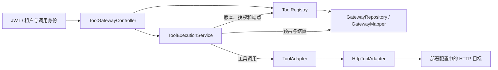

# tool-gateway 工具治理

首期按企业设计稿实现控制面和 HTTP 执行闭环。注册工具、编译版本契约、发布或停用、授予权限是控制面操作。关键词搜索、查 Schema、按版本执行和查询执行记录需要调用权限。实际调用用的是既有 PostgreSQL 的 `gateway` 表。

## 代码怎么分工

| 组件 | 实现 |
| --- | --- |
| [ToolGatewaySecurity](../../modules/access/src/main/java/com/example/enterpriseagent/access/http/ToolGatewaySecurity.java) | Bearer JWT 验证签名、发行方、受众、有效期和 API scope |
| [ToolGatewayController](../../modules/access/src/main/java/com/example/enterpriseagent/access/http/ToolGatewayController.java) | 从 JWT 构造 `GatewayCaller`，将请求转给注册表或执行服务 |
| [ToolRegistry](../../modules/tool-gateway/src/main/java/com/example/enterpriseagent/toolgateway/registry/ToolRegistry.java) | 工具与不可变版本、关键词发现、授权、端点选择、短事务和审计 |
| [ToolContracts](../../modules/tool-gateway/src/main/java/com/example/enterpriseagent/toolgateway/registry/ToolContracts.java) | JSON Schema 2020-12、输入输出校验、对象键排序和 SHA-256 幂等指纹 |
| [ToolExecutionService](../../modules/tool-gateway/src/main/java/com/example/enterpriseagent/toolgateway/execution/ToolExecutionService.java) | 组合注册表、契约和适配器，协调预占、执行结果结算和幂等回放 |
| [HttpToolAdapter](../../modules/tool-gateway/src/main/java/com/example/enterpriseagent/toolgateway/adapter/HttpToolAdapter.java) | 实现 `ToolAdapter`，负责 POST JSON、总等待时间、响应体上限和协议错误归类 |
| [GatewayMapper](../../modules/infrastructure/src/main/java/com/example/enterpriseagent/infrastructure/gateway/GatewayMapper.java) | 继承 `GatewayRepository`，由 MyBatis-Plus 生成代理来执行租户隔离 SQL |

## 一次调用怎样运行

1. 控制面注册工具和版本。版本的输入、输出和端点别名固定。发布和停用锁定工具并比对显式 `expectedRevision`，重新选择已发布版本即可切回该版本。
2. 调用者在搜索或查看 Schema 时需要 `DISCOVER`。执行时还需 `EXECUTE`。匹配到 USER、AGENT 或 ROLE 的显式拒绝覆盖允许。租户、用户及 Agent 从 JWT 取得。
3. `ToolExecutionService.prepare` 在短事务内检查授权、工具或版本状态、风险和输入契约。确认可以派发后，以租户、工具、主体、Agent 和幂等键预占一条执行记录，并记审计。
4. 预占事务提交后才发送 HTTP。目标从部署端点别名白名单查找。请求向上游携带稳定的执行 ID 作为幂等键，并附带追踪 ID。适配器限制等待时间和响应体，不跟随重定向。
5. 成功响应须能解析为 JSON，并按版本契约验证。单独事务写执行状态与审计。超时、网络错误或下游 5xx 会标为 `UNKNOWN`，原幂等键不会重复派发。过期的未结算预占在查询或重放时标记为 `UNKNOWN`。

同一幂等键和同一参数只产生一个执行 ID。重复调用沿用原版本；显式要求不同版本或不同参数时返回 409。同步成功响应包含 `output`，回放和状态查询返回执行状态，结果持久化仍使用设计中的外部存储接入点。数据库中仅记录参数摘要、状态和审计，初始同步响应按登记的输出 Schema 校验。

## 启动配置

使用已建好的数据库，启用 `storage,gateway`。通过 `ENTERPRISE_GATEWAY_ISSUER`、`ENTERPRISE_GATEWAY_AUDIENCE`、可选的 `ENTERPRISE_GATEWAY_JWK_SET_URI` 连接发证方。管理 API 需要 `tools.admin` scope，发现与执行需要 `tools.invoke` scope，并额外检查具体工具授权。JWT 使用 `tenant_id`、`sub`，以及可选的 `agent_id` 和 `roles`。端点别名可用启动参数配置，例如 `--enterprise.gateway.targets.orders=http://127.0.0.1:9000/orders`。实际下游地址由部署环境决定。

| API | 用法 |
| --- | --- |
| `POST /v1/admin/tools` | 创建工具，参数为 `name`、`description`、`riskLevel` |
| `POST /v1/admin/tools/{name}/versions` | 绑定 `version`、`targetRef`、`timeoutMs`、`inputSchema` 与可选的 `outputSchema` |
| `POST /v1/admin/tools/{name}/publish`、`/disable` | 发布或停用。均需 `expectedRevision`，发布另需 `version` |
| `PUT /v1/admin/tools/{name}/permissions` | 设置 `subjectType`、`subjectId`、`action`、`effect` |
| `POST /v1/tools/search`、`GET /v1/tools/{name}/schema` | 根据调用者权限搜索工具和获取 Schema |
| `POST /v1/tools/executions`、`GET /v1/tools/executions/{executionId}` | 带 `Idempotency-Key` 执行，或查询本次调用终态 |

## 简单模型联调

[联调脚本](../../scripts/tool-gateway-smoke.mjs) 会启动临时签名方、局部网关和模拟订单服务，使用 DeepSeek Flash 执行真实工具选择与结果回填。通过 `ENTERPRISE_DB_URL`、`ENTERPRISE_DB_PASSWORD` 指向已用 [建表 SQL](../../database/schema.sql) 初始化的**独立测试库**，并从环境注入 `DEEPSEEK_API_KEY`，然后运行 `node scripts/tool-gateway-smoke.mjs apps/agent-app/target/agent-app-0.1.0-SNAPSHOT.jar`。脚本使用新的测试租户。启用存储 Profile 还需要可用的 Redis 和 Milvus。测试发送给模型的工具和订单均为虚构数据。

首期同步 HTTP 只派发低或中风险且没有额外启用策略的工具。高风险、极高风险或配置了进一步策略的工具返回 `POLICY_REQUIRED`。MCP、动态 ABAC、配额、人工审批续跑、凭证管理和 Outbox 投递按设计分阶段接入。[总体治理设计](../../design/architecture.md#toolgateway-治理)
