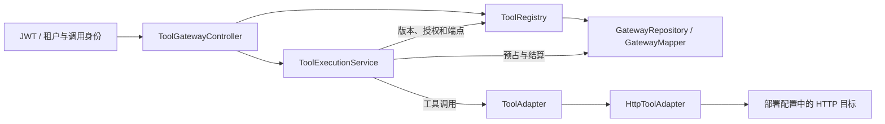
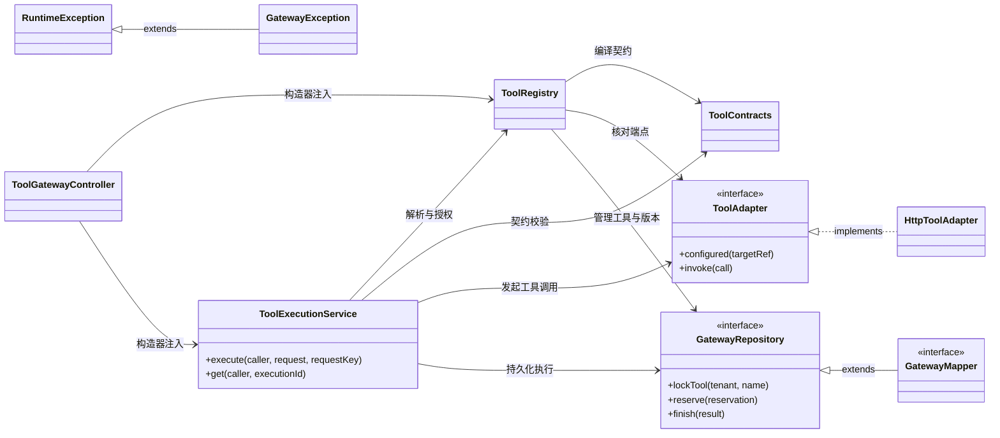
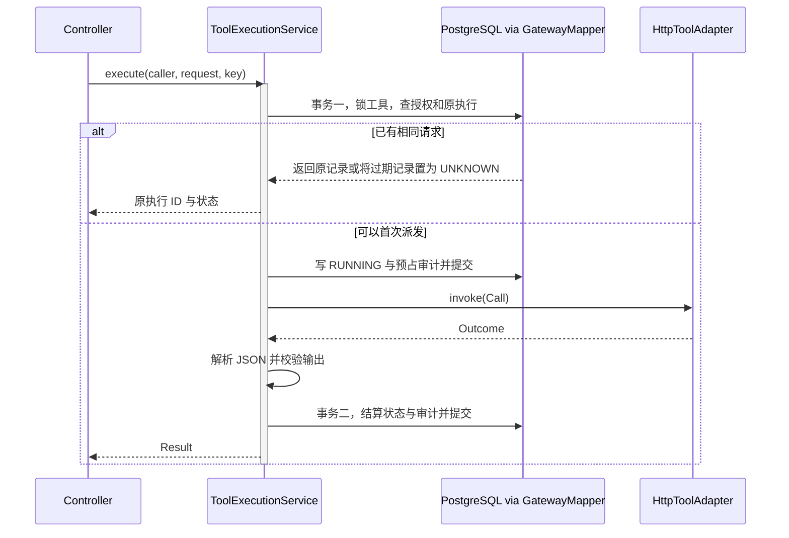

# tool-gateway 工具治理

首期按企业设计稿实现控制面和 HTTP 执行闭环。注册工具、编译版本契约、发布或停用、授予权限是控制面操作。关键词搜索、查 Schema、按版本执行和查询执行记录需要调用权限。实际调用用的是既有 PostgreSQL 的 `gateway` 表。

## 类继承与接口实现

这里有三种关系。类继承看 `extends`，接口实现看 `implements`，对象协作看构造器和持有的字段。网关的业务服务主要用构造器组合，协议和数据库访问通过接口接入。

| 源码声明 | 读法 |
| --- | --- |
| `HttpToolAdapter implements ToolAdapter` | 实现协议适配接口。它用 `@Override` 提供 `configured` 和 `invoke` 的 HTTP 实现。执行服务以接口类型持有它。[ToolAdapter](../../modules/tool-gateway/src/main/java/com/example/enterpriseagent/toolgateway/adapter/ToolAdapter.java) · [HttpToolAdapter](../../modules/tool-gateway/src/main/java/com/example/enterpriseagent/toolgateway/adapter/HttpToolAdapter.java) |
| `GatewayMapper extends GatewayRepository` | 接口继承数据端口。子接口覆盖方法并附加 `@Select`、`@Insert`、`@Update`。MyBatis 生成代理实例，代理可作为 `GatewayRepository` 注入两个业务服务。[GatewayRepository](../../modules/tool-gateway/src/main/java/com/example/enterpriseagent/toolgateway/registry/GatewayRepository.java) · [GatewayMapper](../../modules/infrastructure/src/main/java/com/example/enterpriseagent/infrastructure/gateway/GatewayMapper.java) |
| `GatewayException extends RuntimeException` | 普通类继承。异常携带 `Code` 并由 Controller 映射为 HTTP 状态和错误正文。[GatewayException](../../modules/tool-gateway/src/main/java/com/example/enterpriseagent/toolgateway/GatewayException.java) |
| `BoundedBody implements HttpResponse.BodySubscriber<byte[]>` | HTTP 适配器里的私有类。它将字节交给 JDK 的缓冲订阅器，并统计累计大小。超过上限时取消订阅，用同文件内继承 `RuntimeException` 的 `ResponseTooLarge` 传递失败原因。[HttpToolAdapter](../../modules/tool-gateway/src/main/java/com/example/enterpriseagent/toolgateway/adapter/HttpToolAdapter.java) |

和 [AbstractMemory 的模板方法](memory.md)放在一起看，`AbstractMemory` 让子类重写 `load/save`，统一走父类的 `read/write`。网关的 `ToolExecutionService` 是具体的 `final` 类，它自己定义执行顺序，把持久化、契约和协议调用交给构造器传入的对象。以后接入 MCP 时可以增加该协议的 `ToolAdapter` 实现，并在装配和调用处按协议选择适配器。

## 代码怎么分工

| 组件 | 实现 |
| --- | --- |
| [ToolGatewaySecurity](../../modules/access/src/main/java/com/example/enterpriseagent/access/http/ToolGatewaySecurity.java) | Bearer JWT 验证签名、发行方、受众、有效期和 API scope |
| [ToolGatewayController](../../modules/access/src/main/java/com/example/enterpriseagent/access/http/ToolGatewayController.java) | 从 JWT 构造 `GatewayCaller`，将请求转给注册表或执行服务 |
| [ToolRegistry](../../modules/tool-gateway/src/main/java/com/example/enterpriseagent/toolgateway/registry/ToolRegistry.java) | 工具与不可变版本、关键词发现、授权、端点选择、短事务和审计 |
| [ToolContracts](../../modules/tool-gateway/src/main/java/com/example/enterpriseagent/toolgateway/registry/ToolContracts.java) | JSON Schema 2020-12、输入输出校验、对象键排序和 SHA-256 幂等指纹 |
| [ToolExecutionService](../../modules/tool-gateway/src/main/java/com/example/enterpriseagent/toolgateway/execution/ToolExecutionService.java) | 组合注册表、契约和适配器，协调预占、执行结果结算和幂等回放 |
| [HttpToolAdapter](../../modules/tool-gateway/src/main/java/com/example/enterpriseagent/toolgateway/adapter/HttpToolAdapter.java) | 实现 `ToolAdapter`，负责 POST JSON、总等待时间、响应体上限和协议错误归类 |
| [GatewayMapper](../../modules/infrastructure/src/main/java/com/example/enterpriseagent/infrastructure/gateway/GatewayMapper.java) | 继承 `GatewayRepository`，由 MyBatis-Plus 生成代理来执行租户隔离 SQL |

### Spring 怎样把对象连起来

[ToolGatewayConfiguration](../../modules/infrastructure/src/main/java/com/example/enterpriseagent/infrastructure/ToolGatewayConfiguration.java) 在 `storage,gateway` 两个 Profile 同时启用时装配网关。

1. `@MapperScan` 找到 `GatewayMapper`，注册 MyBatis 代理。`@EnableConfigurationProperties` 将配置里的端点别名和 URI 绑定到 `Endpoints`。
2. `httpToolAdapter(Endpoints)` 创建 `HttpToolAdapter`，并按 `ToolAdapter` 暴露给 Spring。`toolContracts(ObjectMapper)` 用应用的 Jackson 配置创建契约服务。
3. `toolRegistry(...)` 和 `toolExecutionService(...)` 复用 Mapper、契约服务和适配器。两者分别拿到配置为 `REQUIRES_NEW` 的 `TransactionTemplate`。
4. Servlet 模式下，`ToolGatewaySecurity` 装配 JWT Decoder 和 Web 过滤链，`ToolGatewayController` 注入两个业务服务。Controller 从认证后的 JWT 提取 `tenant_id`、`sub`、可选的 `agent_id` 和角色；缺少 `agent_id` 时使用主体标识。输入正文只承载工具名、版本和业务参数。

Maven 依赖方向是 `access → tool-gateway`、`infrastructure → tool-gateway`。例如 Service 调 `GatewayRepository.reserve()` 时，在运行期落到基础设施里的 Mapper 代理，领域模块只使用接口声明。

## 一次调用怎样运行

1. 控制面注册工具和版本。版本的输入、输出和端点别名固定。发布和停用锁定工具并比对显式 `expectedRevision`，重新选择已发布版本即可切回该版本。
2. 调用者在搜索或查看 Schema 时需要 `DISCOVER`。执行时还需 `EXECUTE`。匹配到 USER、AGENT 或 ROLE 的显式拒绝覆盖允许。租户、用户及 Agent 从 JWT 取得。
3. `ToolExecutionService.prepare` 在短事务内检查授权、工具或版本状态、风险和输入契约。确认可以派发后，以租户、工具、主体、Agent 和幂等键预占一条执行记录，并记审计。
4. 预占事务提交后才发送 HTTP。目标从部署端点别名白名单查找。请求向上游携带稳定的执行 ID 作为幂等键，并附带追踪 ID。适配器限制等待时间和响应体，不跟随重定向。
5. 成功响应须能解析为 JSON，并按版本契约验证。单独事务写执行状态与审计。超时、网络错误或下游 5xx 会标为 `UNKNOWN`，原幂等键不会重复派发。过期的未结算预占在查询或重放时标记为 `UNKNOWN`。

同一幂等键和同一参数只产生一个执行 ID。重复调用沿用原版本；显式要求不同版本或不同参数时返回 409。同步成功响应包含 `output`，回放和状态查询返回执行状态，结果持久化仍使用设计中的外部存储接入点。数据库中仅记录参数摘要、状态和审计，初始同步响应按登记的输出 Schema 校验。

### 读源码时跟着这几个值走

假设客户端调用 `orders_lookup`，参数为 `{"orderId":"GWTEST123"}`，请求头 `Idempotency-Key` 为 `order-test-001`。

| 值 | 产生位置 | 用途 |
| --- | --- | --- |
| `GatewayCaller` | Controller 的 `caller(jwt)` | 将租户、主体、Agent 和角色带到查询及授权 |
| `RequestKey` | Service 的 `prepare` | 按租户、工具、Agent、主体和客户端幂等键找到此前请求 |
| `versionId` | Registry 的 `resolve` | 首次调用使用显式版本或默认版本；回放使用已写入执行记录的版本 |
| `operationHash` | Service 的 `prepare` | 以版本 ID 加换行和规范化 JSON 计算 SHA-256。对象键顺序不影响结果，数组顺序保留 |
| `Reservation` | Service 的 `prepare` | 新执行的 ID、端点、版本、指纹与追踪 ID，在事务提交后才允许调用下游 |
| `ToolAdapter.Call` | Service 调用 HTTP 前 | 传入配置的目标别名、超时、参数 JSON、执行 ID 与 Trace ID。适配器用执行 ID 作为下游的幂等键 |
| `Finish` / `Result` | Service 的输出检查与结算 | `Finish` 更新 PostgreSQL 状态，`Result` 给 API 返回执行 ID、状态和可用输出 |

### 两次短事务之间执行 HTTP

- **预占。** 同一个工具行用 `FOR UPDATE` 串行化预占和控制面变更。执行表的唯一键进一步约束同一逻辑请求。参数不符、权限不足或需要高级策略时，业务校验在派发前结束。已存在的请求直接根据原执行处理。
- **下游调用。** HTTP 等待发生在网关两次事务之间。适配器通过固定目标别名构造 POST，设置整体等待预算，响应最多缓冲 256 KiB。数据库的行锁随预占提交释放。
- **结算。** Mapper 只允许本次预占的 `RUNNING` 记录更新，检查租约标识并清除租约。记录被查询判定成 `UNKNOWN` 后，迟到的结算不会回写成成功。

### 出错时由哪一层返回

| 场景 | 路径与结果 |
| --- | --- |
| 缺 token、签名或受众错误 | Spring Security 返回 401 |
| 缺 API scope、工具权限或必须走额外策略 | Security 或网关返回 403 |
| 无效幂等键、JSON 或输入 Schema 不符 | Controller 或服务返回 400 |
| 同一个键换参数或指定另一版本 | 指纹或版本检查冲突，返回 409 |
| 2xx 且 JSON 和输出契约通过 | 结算为 `SUCCEEDED`，执行接口返回 200 和输出 |
| 2xx 但输出不符合要求，或上游返回 3xx／4xx | 结算为 `FAILED`，执行接口返回 502 和归类错误码 |
| 超时、网络异常、响应体过大或上游 5xx | 结算为 `UNKNOWN`，执行接口返回 202，随后可查询状态 |

查询执行记录时，Service 以租户查询 ID，再判断主体和 Agent，最后复核当前 `EXECUTE` 权限。即使初次派发已完成，事后撤权也会影响查询权限。

## 持久化表怎么对应

| 表 | 主要写入点 |
| --- | --- |
| `gateway.tool`、`gateway.tool_version` | 注册工具、登记独立 Schema 版本、发布版本、切换当前版本及停用 |
| `gateway.tool_server`、`gateway.tool_endpoint` | 首期按租户登记受管 HTTP 服务及版本端点。端点记录别名，URI 从部署配置读取 |
| `gateway.tool_permission` | 保存 `DISCOVER` 或 `EXECUTE` 的用户、Agent 或角色授权。Mapper 对匹配的拒绝优先处理 |
| `gateway.tool_policy` | 首期用于检测是否存在启用策略。有记录时进入 `POLICY_REQUIRED` 分支 |
| `gateway.tool_execution` | 保存分配的执行 ID、固定版本、指纹、初始租约及结算状态 |
| `gateway.audit_entry` | 在相应短事务中保存注册、发布、授权变更、预占、结算等审计动作 |

字段、索引和复合外键见 [数据库字典](../../database/dictionary.md)。

## 启动配置

使用已建好的数据库，启用 `storage,gateway`。通过 `ENTERPRISE_GATEWAY_ISSUER`、`ENTERPRISE_GATEWAY_AUDIENCE`、可选的 `ENTERPRISE_GATEWAY_JWK_SET_URI` 连接发证方。管理 API 需要 `tools.admin` scope，发现与执行需要 `tools.invoke` scope，并额外检查具体工具授权。JWT 使用 `tenant_id`、`sub`，以及可选的 `agent_id` 和 `roles`。端点别名可用启动参数配置，例如 `--enterprise.gateway.targets.orders=http://127.0.0.1:9000/orders`。实际下游地址由部署环境决定。

| API | 用法 |
| --- | --- |
| `POST /v1/admin/tools` | 创建工具，参数为 `name`、`description`、`riskLevel` |
| `POST /v1/admin/tools/{name}/versions` | 绑定 `version`、`targetRef`、`timeoutMs`、`inputSchema` 与可选的 `outputSchema` |
| `POST /v1/admin/tools/{name}/publish`、`/disable` | 发布或停用。均需 `expectedRevision`，发布另需 `version` |
| `PUT /v1/admin/tools/{name}/permissions` | 设置 `subjectType`、`subjectId`、`action`、`effect` |
| `POST /v1/tools/search`、`GET /v1/tools/{name}/schema` | 根据调用者权限搜索工具和获取 Schema |
| `POST /v1/tools/executions`、`GET /v1/tools/executions/{executionId}` | 带 `Idempotency-Key` 执行，或查询本次调用终态 |

## 简单模型联调

[联调脚本](../../scripts/tool-gateway-smoke.mjs) 会启动临时签名方、局部网关和模拟订单服务，使用 DeepSeek Flash 执行真实工具选择与结果回填。通过 `ENTERPRISE_DB_URL`、`ENTERPRISE_DB_PASSWORD` 指向已用 [建表 SQL](../../database/schema.sql) 初始化的**独立测试库**，并从环境注入 `DEEPSEEK_API_KEY`，然后运行 `node scripts/tool-gateway-smoke.mjs apps/agent-app/target/agent-app-0.1.0-SNAPSHOT.jar`。脚本使用新的测试租户。启用存储 Profile 还需要可用的 Redis 和 Milvus。测试发送给模型的工具和订单均为虚构数据。

首期同步 HTTP 只派发低或中风险且没有额外启用策略的工具。高风险、极高风险或配置了进一步策略的工具返回 `POLICY_REQUIRED`。MCP、动态 ABAC、配额、人工审批续跑、凭证管理和 Outbox 投递按设计分阶段接入。[总体治理设计](../../design/architecture.md#toolgateway-治理)
